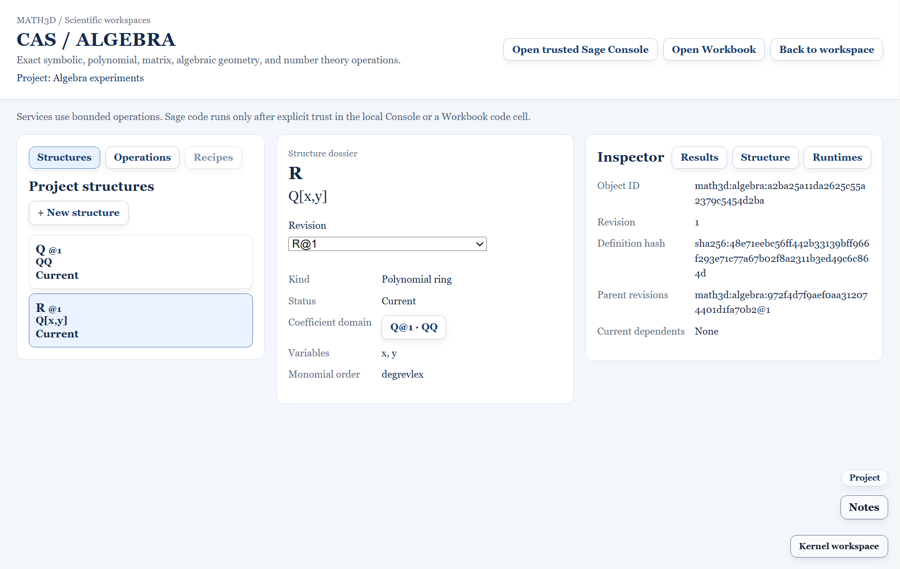

# SAGE-A06 Structures UI and object explorer — 2026-11-03

## Delivered

CAS / Algebra now has **Structures** and **Operations** tabs in its existing workspace. Operations retains the bounded Sage Services flow. Structures reads the active saved Project's A02 algebra registry, shows each object's current or stale state, and opens a central dossier and Structure inspector. The dossier shows the exact revision, kind, coefficient-domain link, variables, monomial order, and A03 stale causes. Historical revisions and archived objects remain selectable for inspection. The inspector exposes the immutable ID, definition hash and pinned parent references.

The `+ New structure` starter creates A01-validated integer rings, rational fields, and polynomial rings over an existing current parent. It rejects duplicate active names, missing or historical parents, stale parents and invalid variables. The full modular and finite-field builder, Sage constructor preview and contextual algebra actions are A07 work. The disabled Recipes tab marks its later rollout.

Creating a structure updates the same saved Project payload and library entry used by Projects. The selected object reference is remembered under that Project ID, checked against the registry on reopen, and restored after an app restart. The Projects panel synchronizes when CAS saves a structure, so its next Save retains the new algebra records.

## Acceptance

- The Project model test created `Q` and `R = Q[x,y]`, serialized and parsed the Project, and reselected `R@1` with the same ID, definition and pinned `Q@1` parent. It also rejected duplicate names, missing and old parents, and duplicate variables.
- The desktop Playwright test created both objects through CAS, confirmed the saved Project has two algebra entries, switched to Operations, saved again through Projects, restarted Electron in the same profile and reselected `R` with the exact prior object ID and definition hash.
- The two existing desktop CAS tests still passed: bounded Services, Inspector and runtime discovery, trusted Console, local Sage, and saving a result to Workbook.
- `npm run typecheck:noemit`, `npm run check:kernel:boundaries` and `npm run build:core` passed. The build reported its existing large-chunk warning.

## Boundary

Creating a structure requires an active saved Project. The form covers the A06 starter set; A07 supplies the complete Ring and Field Builder and live constructor preview. Recipes and structure-specific operation menus remain later roadmap work.
