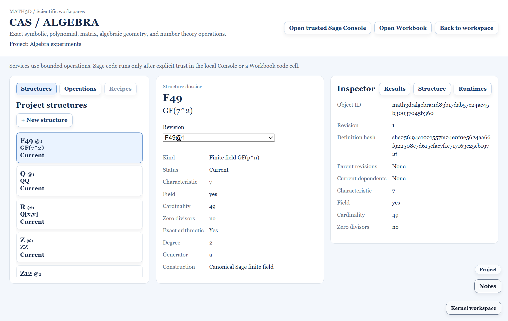

# SAGE-A07 Ring and Field Builder — 2026-11-03

## Delivered

Open a saved Project, then choose **CAS / Algebra → Structures → + New structure**. The central builder creates the five schema-v1 types: `ZZ`, `QQ`, `Z/nZ`, canonical `GF(p^n)`, and polynomial rings over a current saved coefficient domain. The form exposes modulus, prime characteristic, extension degree, generator, pinned coefficient-domain revision, variables, and monomial order as appropriate. A validation and preview step is required before **Create and save**. Changing a field or the Project invalidates that preview.

Validation uses the A01 object schema, A02 Project registry, and A04 bounded reconstruction envelope. It rejects duplicate names, invalid moduli and generators, nonprime field characteristics, finite-field cardinality above 65536, invalid polynomial variables, and unavailable, historical, or stale coefficient domains. For `Z/nZ`, small moduli are classified locally as prime fields or composite rings with zero divisors. Larger moduli remain explicitly undecided until Sage checks them.

The preview reports exact characteristic, field status, cardinality, zero divisors, and polynomial parent. When Docker Sage advertises `sage.algebra.reconstruct`, the builder runs the validated candidate definition through the shared bounded broker and shows Sage's constructor text and version. A failed constructor or mismatched response blocks save. When the runtime is unavailable, the builder identifies local-only validation. The saved dossier and Structure Inspector recompute the exact domain facts after reopen, alongside immutable object ID, definition hash, revision, and parent references.

Finite fields use the A01 **canonical Sage construction** policy. The Project records `p`, `n`, and generator name; a particular defining polynomial is not pinned across Sage versions. Quotient rings, number fields, and p-adic fields remain later schema and UI work in the broader P0 roadmap.

## Acceptance

- Model tests built `ZZ`, `QQ`, `Z/12Z`, `Z/13Z`, and `GF(7^2)`, roundtripped them through a Project, checked characteristic, field and zero-divisor status, and rejected malformed definitions.
- Desktop Electron tests created all five builder types, rejected invalid modulus and nonprime characteristic, saved the Project, restarted independently, and recovered the same `GF(7^2)` object ID and definition hash. Existing CAS Services and Workbook desktop tests passed.
- A mocked Docker capability and constructor returned exact Sage 10.10 metadata to the builder. A second response with a forged definition hash was rejected before Project save.
- Live Sage 9.5 WSL worker tests reconstructed prime `Z/13Z` and `GF(7^2)`, alongside the existing `ZZ`, `QQ`, composite `Z/12Z`, and polynomial-ring cases.
- `npm run build:core`, renderer TypeScript checking, and `npm run check:kernel:boundaries` passed. The full `typecheck:noemit` command reaches the E2E TypeScript project, which currently resolves shared `node_modules` packages from the original dirty checkout and reports unrelated errors in its uncommitted `packages/core/src/scientificSelectionLegacy.ts`. The isolated A07 worktree's renderer TypeScript check passed.

## Next

**SAGE-A08** should compare canonical object fixtures and advertised operations across Sage 9.5 Local WSL and Sage 10.10 Docker when Docker is available. It should report concrete runtime limitations in the UI, including reconstruction unavailable on the current Local WSL application route.
