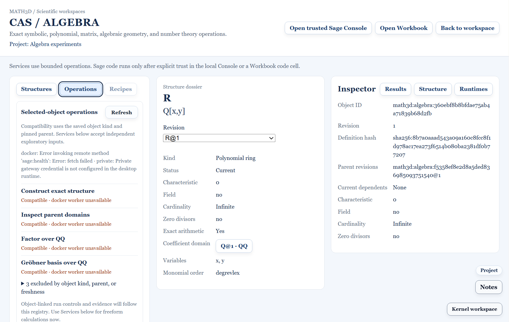

# SAGE-B01 typed algebra operation registry — 2026-11-04

## Delivered

The core [algebra operation registry](../../packages/core/src/algebraOperationRegistry.ts) maps seven existing bounded Sage operations to saved Project objects, exact argument contracts, broker capability keys, supported app routes and validated result shapes. It separates mathematical eligibility from current runtime availability. Every object-linked request pins a current, fresh object revision; archived, historical and stale records are rejected.

| Selected object | Eligible object operations |
|---|---|
| `ZZ` | Reconstruct, inspect parent domains, integer GCD |
| `Z/nZ` | Reconstruct, inspect parent domains, modular inverse with modulus taken from the saved definition |
| `QQ` or `GF(p^n)` | Reconstruct, inspect parent domains |
| Polynomial ring with a direct `QQ` parent | Reconstruct, inspect parent domains, factorization, Gröbner basis; exact roots only with one variable |
| Polynomial ring over another domain | Reconstruct and inspect parent domains; the current polynomial worker constructs its freeform inputs over `QQ` |

The registry rejects extra fields and executable arguments, noncanonical integers, unknown polynomial variables, excessive exponents and oversized argument lists. It builds the existing A04/A05 typed envelopes for structure operations; it derives modular inverse modulus from the selected `Z/nZ` record. Result parsing checks exact schemas, pinned IDs and hashes where the worker supplies them, and bounded result shapes for number theory and polynomial operations. No new user-code execution route was added.

In **CAS / Algebra → Operations**, a new selected-object section lists only compatible operations and reports which advertised runtime can serve them. Excluded operations are available under a disclosure with the kind, domain or freshness reason. The existing Services form remains available for independent exploratory calculations. Contextual object-linked run controls and saved evidence remain the planned **SAGE-B05** work; this B01 list is a validated compatibility and capability view.

## Acceptance

- Core tests verified the `ZZ`, `Z/12Z`, `QQ`, `QQ[x,y]`, `QQ[t]` and `GF(7^2)[t]` filters, historical and stale revision rejection, offline versus mathematically incompatible status, bounded requests, and malformed result rejection.
- A renderer test checked every registry capability key against the shared Sage broker's registered operation type.
- Desktop Electron tests selected `GF(7^2)`, `Z/12Z` and `QQ[x,y]` and confirmed the Operations list changes with kind and direct parent. Existing CAS Services, Inspector and Workbook acceptance tests passed.
- `npm run typecheck:noemit`, `npm run build:core` and `npm run check:kernel:boundaries` passed. Docker Sage is unavailable on this PC, so the UI correctly reports the worker as unavailable while preserving mathematical eligibility.

## Next

**SAGE-B02** adds a polynomial dossier recipe with exact factorization, square-free decomposition, derivatives, discriminant and roots. **SAGE-B05** later makes validated object operations directly executable from the selected-object list with linked evidence.
