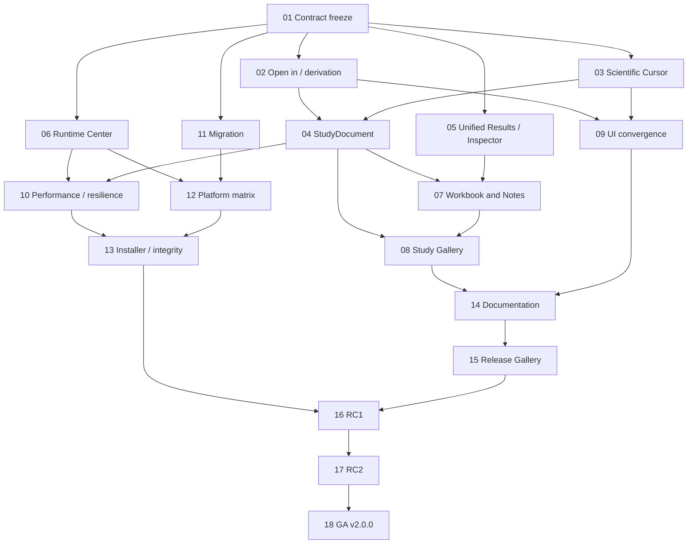

# MATH3D 2.0.0 — Unified Scientific Workspace

**Product roadmap · Architecture / UX / Scientific interoperability / Release engineering**<br>
**Prepared:** 2026-11-05<br>
**Updated:** 2026-11-09<br>
**Target:** Math3D 2.0.0 General Availability (GA)<br>
**Status:** Architecture, workflow, documentation, and release-gate work is merged to `main`; RC1, RC2, and GA are not declared. Root and renderer packages still report 1.7.0, and no `v2.0.0` tag exists.<br>
**Primary product claim:** *Construct, compute, analyze, compare, document, and publish connected mathematical objects in one scientific workspace.*

> **Release principle.** Version 2.0.0 is not another sequence of independent scientific-module expansions. It is the release that makes the already substantial Geometry, Curves, Surfaces, Mesh, Volume, Graphs, Field Explorer, Topology, CAS/Sage, Projects, Workbooks, and Quantum capabilities behave as **one integrated, reproducible scientific application**.

---

## Delivery snapshot — 2026-11-07

| Milestone | On `main` | Still required for 2.0 acceptance |
|---|---|---|
| 01–02 · Contracts and handoffs | Adapter registry, compatibility fixtures, bounded `Open in…` actions, and saved return navigation | Architecture approval and all three complete flagship journeys |
| 03–10 · Integrated product | Existing module, selection, Project, Workbook, runtime, and gallery capabilities described below | General shared cursor and Study model, coherent result/runtime UI, flagship evidence, and performance acceptance where advertised |
| 11–12 · Migration and hosts | Source-format migration/transfer fixtures and scoped Windows, local-browser, and mobile-model tests | Published 1.x corpus and installed/hosted/device/package evidence for each claimed host |
| 13–15 · Distribution and communication | Pinning and integrity checks, clean-install/upgrade scripts, user guides, capability page, and source gallery provenance | Exact signed 2.0 candidate, installed tests, candidate captures, and matching public claims |
| 16 · RC1 | Freeze verifier, repeatable source acceptance runner, and blocker register | Reviewed 2.0 integration commit, clean freeze manifest, full CI and defect disposition |
| 17 · RC2 | Pinned source migration corpus, independent resource transfers, timed soak runner, and exact-candidate rehearsal verifier | Two-hour soak, exact-artifact install/upgrade, host-specific receipts, and written sign-off for one commit and manifest |
| 18 · GA | Legacy 1.x publish-path guard, reviewed sign-off verifier, immutable asset staging, and uploaded-download audit | Approved zero-blocker receipt, `v2.0.0` tag, publication, final downloaded install, and remote-byte audit |

The gate scripts and source tests are **preparation**, not evidence that a 2.0 installer or release has passed. The local source checkout remains version 1.7.0. Keep installer execution at the final qualification stage; only promote a capability or checklist item after evidence names the exact candidate commit and artifact hash.

**Immediate P0 release blocker — QI-40:** The currently published v1.7.0 Windows installer still contains the NSIS component seen in intermittent installer crashes. The [production fix](https://github.com/expert10000/Math3D/pull/29) is on `main` and passed 36/36 exact-file installs on Windows 2022 and Windows latest, plus installed UI/QEC, rollback, and upgrade in a [nonpublishing signoff](https://github.com/expert10000/Math3D/actions/runs/42396101411). It has not changed the published download. An earlier installed current-main candidate exceeded the QI-40 memory target: 2,832,516 bytes late growth against 2,097,152 bytes. The toolchain fix must reach the actual 2.0 packaging path and the memory gate must pass on the exact 2.0 release candidate; see the [installation and upgrade gate](INSTALL_UPGRADE_GATE.md).

**Next release path:** qualify the merged installer toolchain fix in the 2.0 packaging path, diagnose the installed memory excess, close or explicitly limit the shared cursor/Study and three flagship journeys, and resolve the native CGAL source-bundle blocker. Then choose and review a 2.0 integration baseline, run the RC1 freeze and acceptance matrix, and qualify the signed candidate, migration, soak, gallery, and host claims. GA sign-off, tagging, staging, publication, and verification of downloaded bytes follow that evidence.

**Flagship source gate (2026-11-10):** `node scripts/release20-flagship-journeys.mjs --plan` lists the bounded Surface, QWZ and algebra desktop journeys; `--run <evidence-json>` requires a clean tracked checkout and built core, then writes a commit-pinned receipt with test-file and output hashes. The guided Catenoid evidence copy now saves a Surface/Mesh Study whose Mesh member cites the recorded curvature result and can navigate to Results after cold restart. Bounded Surface comparison and QWZ profile publication now have separate desktop acceptance, but this gate does not certify the full roadmap journeys or installed candidate.

**Native CGAL source integration (2026-11-10):** The Windows public-source inventory now selects the native reference build's CGAL 6.2.1, Boost 1.92.0, GMP 6.3.0, MPFR 4.2.2 and pinned vcpkg recipes. The release workflow verifies every archive hash and the exact Git source archive before asset staging; the SBOM records the sources and fails on an unowned optional native binary. Installer inclusion remains opt-in and requires that source receipt plus the pinned local build. This is a source-distribution gate implementation, not evidence of a built, signed or installed 2.0 candidate.

**Study cursor qualification (2026-11-11):** A saved two-pane Surface/Mesh Study can now link a transient physical coordinate marker when both pinned documents replay and declare the same frame and units. Graph/Curve promotion, Curve/Surface chart, and four-pane QWZ links remain separately qualified; the Study view states why an incompatible or changed pair is disabled. The Surface/Mesh marker does not infer a Mesh vertex, analytic curvature, or correspondence between unrelated elements. The focused desktop journey saves and cold-reopens this link. Complete coordinate propagation into every native module Inspector remains an open broader acceptance item.

**Bounded Catenoid publication (2026-11-11):** The guided cosh-revolution Project now saves a sampled waist Curve, exact analytic waist reference, one local discrete Mesh curvature estimate with its error, a pinned comparison result, and a Workbook reference. Desktop acceptance exports the comparison after a cold reopen, withholds it when the Surface generation changes, and blocks opening when saved Mesh source bytes are missing. The comparison is explicitly a local sampled estimate, not a convergence proof or a general ridge detector. Native Surface ridge selection and installed-candidate evidence remain open.

**Bounded QWZ profile publication (2026-11-11):** A pinned, source-qualified reciprocal sample now derives a constant-coordinate band-energy section of at most 65 producer samples, saves a point-series Graph and result with exact source relations, and includes the profile in the Study evidence export. Desktop acceptance covers cold restart, a changed source bundle, missing band bytes, and retention of the Quantum Study layout after Graph capture. The section uses verified producer values; it is not an independent band computation or a general path editor. Full installed-candidate and arbitrary reciprocal-path acceptance remain open.

**Saved algebraic locus and singularities (2026-11-11):** A current, single-polynomial CAS locus can run the brokered Sage symbolic singularities operation on an advertised desktop route and save the exact response, engine, source revision, and locus Geometry relation in Project. The bounded real sample and tangent inspection retain separate visualization provenance; reopening the saved Project reads these records without running Sage. Focused desktop acceptance covers an unavailable service, cancellation, successful save, bounded Geometry, and offline cold reopen; source revision refusal and JSON reimport are checked in the focused source tests. General ideals, arbitrary dimensions, installed-candidate runtime evidence, and symbolic validation independent of Sage remain open.

---

## 0. Executive decision

### 0.1 Why now

The established professional programs for Geometry, Curves, Surface Analysis, Mesh Analyze, and Volume already have extensive implementation and acceptance records. Projects retain cross-document source relations, exact generations, results, sidecars, Notes, Workbooks, and comparisons. Graph ↔ Field Explorer has developed a common selection and derived-field path. Sage/CAS is evolving from freeform commands into typed Project-owned algebraic objects and recipes. Theory-Lab/Quantum scenes have a versioned import and integration path. Desktop, browser, mobile, and scientific workers already have substantial infrastructure.

The next strategic advantage is **coherence**, not raw module count. A 2.0 user should be able to cross a module boundary without losing the selected mathematical object, coordinate frame, time/parameter position, computation evidence, or return navigation.

### 0.2 Release identity

**Name:** Math3D 2.0 — Unified Scientific Workspace<br>
**Short description:** A project-based mathematical environment combining interactive visualization, scientific computation, exact mathematics, derived objects, comparisons, and reproducible reports.<br>
**Positioning:** More than a 3D plotter; not an attempt to replace all of SageMath, MATLAB, ParaView, Blender, GeoGebra, Jupyter, or general CAD. Math3D is the *bridge* among mathematical representations, results, and scientific interpretation.

**Five release promises:**

1. **One Project:** Related objects, their identities, derivations, saved results, Notes, Workbooks, and optional Study layouts live together.
2. **One scientific interaction model:** The selection/cursor/Inspector contract is consistent even when the mathematical meaning changes by domain.
3. **One result lifecycle:** Computing, verified, computed-but-not-certified, historical, stale, missing, failed, and unsupported states are truthfully distinguished.
4. **One interoperability experience:** A qualified `Open in…` operation records lineage, never silently discards method or source information, and provides an explicit return path.
5. **One trustworthy release:** Clean install, upgrades, migration, runtime capability reporting, resource integrity, performance, and recovery are tested as release blockers.

### 0.3 Scope priorities

| Work class | Proposed share | Notes |
|---|---:|---|
| Integration, UX convergence, reliability | 60% | Highest product leverage; avoid duplicating existing engines |
| Packaging, acceptance, documentation, release evidence | 25% | Required for a credible main release |
| Carefully bounded new capability | 15% | Scientific Cursor, StudyDocument, global command/search, common Runtime Center |

These percentages are planning guidelines, not estimates of remaining development.

### 0.4 Release semantics

- **P0:** Required for GA, unless a documented capability-limited alternative passes an explicit release decision.
- **P1:** Strongly desired for GA, but may move to 2.0.1/2.1 if it threatens quality or compatibility.
- **P2:** 2.1+ candidate, not a GA blocker.
- **Stop-the-line:** Data loss, silent scientific mislabeling, invalid provenance, a security-sensitive runtime exposure, broken 1.x migration, or supported clean-install failure.
- **Feature freeze:** Once RC1 starts, only release blockers, docs corrections, and validated low-risk fixes enter the branch.

**Important distinction:** Existing dated repository evidence demonstrates bounded implementations, *not automatic 2.0 production certification*. Every GA requirement below needs evidence against the exact release commit and distributable artifacts.

---

## 1. Current baseline and the 2.0 gap

| Area | Broad established baseline | Remaining 2.0 concern |
|---|---|---|
| Surface Analysis | Unified analysis request/result, curvature, geodesics, parameter diagnostics, Surface→Mesh | Same actions/Inspector semantics across unrelated modules |
| Geometry | Professional construction/analysis, semantics, provenance, Mesh round trips | More consistent cross-workspace selection and `Open in…` |
| Curves | Adaptive sampling, moving frames, probes, NURBS, diagnostics and interoperability | Unify selection/cursor and linked plots |
| Mesh | Quality, curvature, scientific inspector, cached analysis, retained generations/comparison | Compact reusable result cards, stress/performance stability |
| Volume | Slice/quad, transfer functions, segmentation, SDF, fields, comparison | Shared scientific cursor and cross-domain handoff qualification |
| Graphs | 2D/3D graphing, analysis, probes, presets, mobile work | Standard cross-source profile/navigation behaviour |
| Field Explorer | Vector/scalar workflows, derived profiles, trajectory/comparison/time work | Make inverse link from a Graph profile discoverable |
| Projects | Multi-document ownership, exact histories, relations, results, compositions | Make relationship map, Study and evidence navigation a main product concept |
| Workbooks/Notes | Typed references, result evidence and source verification paths | Uniform linked result blocks and portable publication semantics |
| CAS/Sage | Versioned algebra objects, typed operations and recipes, local and hosted work | Bounded, truthful runtime portability and representational handoffs |
| Quantum | Scene import, scientific scenes, time/field integrations, integration evidence | Three polished Study exemplars and a shared cursor/explanation experience |
| Desktop/browser/mobile | Multiple host-specific implementations and release tracks | Support matrix, migration, installer, predictable limited-capability UI |

### 1.1 Existing contracts should be reused

Start with a **contract inventory** of existing ProjectDocument/Math3DProject, document identities, scene resources, saved `AnalysisResult`, scientific selections, worker brokers, runtime capability probes, Notes/Workbook references, and source hash mechanisms. No new interface should be added without documenting whether it extends an existing contract or replaces an incompatibility.

**Rule:** do not create a second Project identity model, a second result registry, a second generic job runner, or an independent quantum-specific scientific cursor.

### 1.2 Three end-to-end journeys define success

1. **Surface journey:** Create Surface → Gaussian curvature → select ridge → promote Curve → generate Mesh → analyze discrete curvature → compare exact/discrete evidence → add Workbook → reopen and publish.
2. **Quantum journey:** Open QWZ Study → choose reciprocal k-point → synchronize curvature, bands and Inspector → derive path/profile → open Graph → save result → publish evidence-backed Study.
3. **Algebra journey:** Create polynomial/ideal in CAS → compute algebraic locus via supported runtime → open bounded Curve/Geometry/Surface representation → inspect singularities → save exact result and visualization provenance → reopen without silent recomputation.

Each journey requires explicit expected outcomes for **valid**, **stale**, **offline**, **missing resource**, **cancelled**, **modified source**, and **reimported** cases.

---

## 2. Target information architecture

### 2.1 Objects, Projects, Studies and Workbooks

```text
Math3D Home
├── Recent
├── Projects
│   └── ProjectDocument
│       ├── Documents (Graph, Curve, Surface, Geometry, Mesh, Volume, ...)
│       ├── Algebra objects / computation sources
│       ├── Scientific scenes and verified resources
│       ├── Derived objects and relations
│       ├── Analysis results and artifacts
│       ├── Studies (saved linked-view configurations)
│       ├── Workbooks
│       ├── Notes
│       └── Revision and provenance records
├── Studies (Project-owned, independently discoverable)
├── Gallery / Guided studies
├── Search / Commands
└── Runtime Center
```

**Non-negotiable:** StudyDocument is a Project-owned orchestration/layout reference; it is **not** the owner of participating scientific documents, their underlying bytes, or their mathematical results.

### 2.2 User action grammar

Standard top-level verbs: **Create · Analyze · Display · Inspect · Derive · Compare · Publish**.

- **Create:** new source object or document.
- **Analyze:** issue a versioned computation request.
- **Display:** view an existing representation/layer; no implied recomputation.
- **Inspect:** explain current selection, stored result, identity, units and evidence.
- **Derive:** create a new source-linked object through an explicit transformation.
- **Compare:** compare compatible saved/current sources with appropriate alignment qualifications.
- **Publish:** export a frozen, verifiable snapshot/report, with appropriate source omission rules.

Avoid terms that obscure whether an action computes, reuses cached data, changes presentation, or creates a new revision.

### 2.3 Workspace responsibilities

```text
┌─────────────────────┬─────────────────────────────────┬──────────────────────┐
│ LEFT: Source & tools│ CENTER: Scientific view         │ RIGHT: Inspector     │
│ Project navigator   │ Canvas / 2D / 3D / Study layout │ Selection            │
│ Object hierarchy    │ Display layers and comparison   │ Results              │
│ Contextual actions  │ Linked views                    │ Provenance           │
│ Create / Analyze    │ Scientific Cursor               │ Verification         │
├─────────────────────┴─────────────────────────────────┴──────────────────────┤
│ OPTIONAL BOTTOM: jobs, timeline/playback, diagnostics, console (contextual) │
└─────────────────────────────────────────────────────────────────────────────┘
```

Responsive modes: desktop three-region, compact desktop two-region, tablet one active companion at a time, mobile full-screen viewer with bottom-sheet inspector. Study layouts can downgrade to single-view switching without corrupting the saved multi-view specification.

---

## 3. Shared scientific contracts

### 3.1 ScientificSelection v2

A selection is a **typed reference to a meaningful mathematical location or entity**, not merely a screen pixel or a generic `{x,y,z}`.

Illustrative TypeScript shape (design proposal, not a declaration of current repository APIs):

```ts
type ScientificSelectionV2 = {
  schemaVersion: 2;
  id: string;
  projectId: string;
  source: {
    documentId: string;
    documentRevision: string;
    resourceHash?: string;
    resultId?: string;
  };
  domain:
    | { kind: "world-point"; xyz: [number, number, number]; frameId: string }
    | { kind: "surface-uv"; u: number; v: number; chartId?: string }
    | { kind: "curve-t"; t: number; arcLength?: number }
    | { kind: "graph-x"; x: number; seriesId?: string }
    | { kind: "mesh-entity"; entity: "vertex" | "edge" | "face"; index: number }
    | { kind: "field-sample"; position: [number, number, number]; time?: number }
    | { kind: "volume-voxel"; ijk: [number, number, number] }
    | { kind: "reciprocal-k"; k: number[]; reciprocalFrameId: string }
    | { kind: "algebra-object"; objectId: string; objectRevision: string };
  units?: Record<string, string>;
  confidence?: { kind: "exact" | "interpolated" | "approximate"; error?: number };
};
```

**Requirements:**

- Schema/identity validation, no implicit frame mixing.
- Preserve source revision and canonical resource identity.
- Local selection vs linked selection vs persistent saved selection are distinct lifetimes.
- Invalidate or classify stale references after edits; never silently rebase indices.
- Map between spaces only through explicit, versioned maps with appropriate approximation/error semantics.
- A derived Mesh vertex may map back to a parameterized Surface through a recorded mapping; arbitrary unrelated meshes must not imply correspondence.
- Presentation can reflect an unavailable or partial mapping without losing the original local selection.

### 3.2 Scientific Cursor v1

The Cursor is a *coordinator* of selection targets and compatible coordinate mappings, not a universal physical point.

```text
User pick / plot crosshair / timeline move / parameter slider
                   │
                   ▼
           Scientific Cursor
              │    │    │
              │    │    └────► Inspector observations
              │    └─────────► Linked Graph / profile cursor
              └──────────────► Surface / Mesh / Field / reciprocal view
```

**Modes:** inspect-on-hover (ephemeral), click-lock, pinned annotation, linked study cursor, timeline-follow; only persisted modes belong in a saved Study/Project. Cross-module updates carry an origin token to avoid feedback loops. Progressively update inexpensive local readouts first; expensive derived computations require explicit requests or controlled opt-in.

**Special cases:**

- Undefined curvature at singularity → `undefined` with reason, not zero.
- Mesh sample interpolated across a face → label interpolation and method.
- Reciprocal coordinates → explicit lattice basis; do not treat `k` as world `xyz`.
- Quantum time evolution → pinned time and simulation state identity.
- Missing source or stale map → display last pinned selection with disabled linked propagation and reason.
- Incompatible dimension → no correspondence claim; viewer remains interactive locally.

### 3.3 Unified AnalysisResult / Result Card

Do **not** invent a parallel result persistence format. Define one presentation/view model over existing validated result envelopes:

```text
Gaussian curvature
────────────────────────────────────
Source      Catenoid · revision 17
Method      Analytic differential geometry
Engine      Math3D Surface · version ...
Status      Verified / computed / historical / stale / ...
Units       1 / length²
Range       [min, max] (when meaningful)
Artifacts   field / plot / binary resource

Show · Inspect · Compare · Open as Field · Add to Workbook · Export
```

**Status taxonomy:**

| Status | Meaning | Allowed actions |
|---|---|---|
| Verified | Exact source and declared checks pass | Show, inspect, reference, export |
| Computed / not independently verified | Runtime returned result but verification strength is limited | Show with qualifier; avoid certified labels |
| Historical | Result valid for an earlier retained revision | Inspect and compare if supported; no silent promotion |
| Stale | Dependency/source advanced or changed | Preserve record; require explicit refresh/fork |
| Missing | Required resource/result unavailable | Show metadata only; no fabricated values |
| Unsupported | Capability/domain not available | Explain prerequisite or restriction |
| Failed | Execution attempted and failed | Inspect error; retry after user action |
| Cancelled | User/system cancelled job | Preserve completed independent evidence as allowed |

**Separate three axes:** transport/execution success, source/resource integrity, and mathematical verification. “Worker succeeded” must not automatically equal “mathematically certified.”

### 3.4 Unit, frame and numerical semantics

All cross-document operations must state applicable frame, units, orientation, time basis, numerical approximation policy and uncertainty. Length, area, curvature, reciprocal lattice units, scalar field units, dimensionless quantum probabilities, and mesh index spaces cannot be inferred from appearance. Comparison differences are shown only when compatible. Provide conversion when declared and reversible, refusal otherwise.

### 3.5 Provenance graph

```text
Source@revision/hash
      │
      ├─ operation + parameters + method + runtime version
      ▼
Derived object@revision/hash
      │
      ├─ analysis request + result identity
      ▼
Result + artifact hashes + verification
      │
      ├─ view configuration / selection
      ▼
Study / Workbook / Note
      │
      ▼
Verified publication snapshot
```

Edges exist only if recorded. Never infer scientific provenance from similar object names, scene positions or parameter values. Use the existing Project relationship and resource registries as the source of truth.

---

## 4. StudyDocument — flagship bounded capability

### 4.1 Purpose

A `StudyDocument` saves a scientifically meaningful *assembly of linked views*. It is not a duplicate of a Project, nor an alternative document container. Start with a Project-owned Study record if introducing an entirely new document subtype would destabilize migrations.

```text
Project: QWZ Topological Phase
└── Study: QWZ phase and Berry curvature
    ├── Quantum scene source
    ├── Berry-curvature field view
    ├── Band-structure graph view
    ├── Reciprocal-space viewer
    ├── Linked Scientific Cursor
    ├── Parameter/time configuration
    ├── Inspector selection
    └── Saved evidence / Workbook references
```

### 4.2 Minimal persistent model

```ts
type StudyRecordV1 = {
  schemaVersion: 1;
  id: string;
  projectId: string;
  title: string;
  description?: string;
  members: Array<{
    memberId: string;
    documentId: string;
    documentRevision?: string;
    resultId?: string;
    role: "source" | "derived" | "analysis" | "visual";
  }>;
  layout: {
    mode: "single" | "split-2" | "quad" | "tabs";
    panes: Array<{ paneId: string; memberId: string; viewConfigId?: string }>;
  };
  links: Array<{
    id: string;
    kind: "cursor" | "parameter" | "time" | "camera";
    sourcePaneId: string;
    targetPaneId: string;
    mappingId: string;
    direction: "one-way" | "two-way";
  }>;
  pinnedSelectionIds: string[];
  notesRefs?: string[];
  workbookRefs?: string[];
};
```

Illustrative only; adapt to the existing Project and composition schema instead of copying it wholesale.

### 4.3 Study interactions

- New Study from Project selection; choose 2–4 compatible document/result views.
- Templates: comparison, field + profile, surface + curvature + mesh, QWZ, SSH, orbital slice + isosurface, algebraic locus.
- Save/reopen viewer arrangement and explicit selection links.
- Define per-pane camera and display layers; synchronize only when coordinate qualification permits.
- Inspector indicates which pane/selection it explains; “pin Inspector to pane” is optional.
- Study→source and source→Study navigation retains original document ownership.
- Missing member: show a readable placeholder, not a blank canvas or crash.
- Scientific computations remain owned by the member document/runtime; opening a Study must not compute everything eagerly.

### 4.4 Performance protection

- Lazy mount only visible panes; suspend hidden WebGL canvases and subscriptions.
- One shared resource identity and cache per immutable scene/resource, where safe.
- Limit concurrent expensive viewers and jobs via runtime budgets.
- Study must close/restore without leaked GPU contexts, workers, subscriptions or transient results.
- Mobile fallback uses one active pane + a view switcher and preserves the original desktop layout in the saved record.

### 4.5 Gate

Save a four-pane QWZ Study, cold-restart Electron, independently export/import the Project, verify each source and selected `k` point, toggle an offline runtime, navigate to source and back, alter one source hash, and ensure stale linked values are withheld without losing the rest of the Study.

---

## 5. Universal `Open in…` and derivation registry

### 5.1 Contract

The action is an explicit operation resolution, not unqualified conversion. Registry descriptors should define:

- source and target types;
- required geometry/field representation and coordinate frame;
- engine/capability dependency;
- whether operation creates a new document, a saved result, a projection, or a read-only view;
- reversible navigation/back-link semantics;
- approximations, losses and unit changes;
- eligibility/disabled reason;
- resource and memory budgets;
- source revision/hash and resulting recorded relation.

### 5.2 Initial supported families

| From | Target | Conditions / semantics |
|---|---|---|
| Graph | Surface | Revolution/extrusion/qualified construction; retain source function |
| Curve | Surface | Sweep/revolution/ruled operation where supported; record parameters |
| Surface | Mesh | Sampled tessellation; explicit approximation/error/bake semantics |
| Surface | Graph | Parameter-line or scalar profile with a saved selection |
| Surface | Field Explorer | Derived surface scalar/vector field when evaluator supports it |
| Mesh | Curve | Boundary/feature/path extraction with source mapping |
| Mesh | Volume | SDF/voxelization with resolution and sign qualifiers |
| Volume | Mesh | Isosurface extraction with threshold, interpolation and source map |
| Field | Graph | Saved spatial profile, time-series or other qualified projection |
| Graph | Field | Return to recorded spatial selection; not inverse reconstruction |
| Quantum scene | Field/Surface/Graph | Producer-neutral typed resource interpretation |
| CAS algebraic locus | Curve/Geometry/Surface | Bounded representation only, with exact vs sampled distinction |
| Result | Workbook | Reference immutable result/source evidence, not just visible numbers |

A capability should be displayed as `Supported`, `Available with approximation`, `Offline`, `Incompatible`, or `Not implemented` with actionable explanation. Do not present a destination merely because the viewer can draw a collection of points.

### 5.3 UX

Select object → `Open in…` → destination list → inspection of conversion conditions → commit derivative/view → return link. Batch action is P1 only when bounded and already supported by the backend.

### 5.4 Acceptance

Each supported adapter has truth fixtures, cross-module navigation, independent restart/import, stale-source refusal, cancellation/race protection and missing-capability diagnostics. Cross-module actions cannot bypass the Project's scientific data validation.

---

## 6. Project Center and relationship map

### 6.1 First-class Project navigation

Recommended top-level Project sections: **Overview · Documents · Studies · Relations · Results · Workbooks & Notes · History** (merge sections on compact layouts if necessary). Keep the current Project Navigator in the left companion rather than duplicating detailed controls in the central view.

### 6.2 Relationship map behaviour

```text
Graph ──revolve──► Surface ──tessellate──► Mesh ──analyze──► Result
                         │                                  │
                         └──probe/profile──► Graph          └──► Workbook
```

- Source, derived, result, artifact, Study and publication links are visually distinct.
- Edge click opens recorded operation, engine, parameters, input/output revision, hash and evidence state.
- Node click opens native module at the matching retained generation when available.
- Missing/historical sources remain represented, with explicit unavailable information.
- Filter by `current`, `stale`, `historical`, `missing`, type, module, recent activity (only where timestamps actually exist).
- No inferred chronology where old Project records lack edit timestamps.
- For large Projects, collapse subgraphs or show neighbourhoods instead of rendering thousands of nodes.

### 6.3 Project-wide Inspector

A Project Results browser should use the same Result Card and exact-resource validation as module-level Inspectors. A single route should open a saved result, the originating object/revision, relevant Study, and referencing Workbook blocks/Notes.

---

## 7. Graphs and Field Explorer convergence

### 7.1 Separate responsibilities

- **Field Explorer:** the vector/scalar field and physical domain, regions, trajectories, derivatives, topology and space/time visualization.
- **Graphs:** functions, sampled profiles, scalar/time series, curve plots, comparative analysis and quantitative exploration.

Do not merge all tools into one menu. Unify the *relationship* and shared selection semantics.

### 7.2 Preferred workflow

```text
Verified vector field
 ├─ magnitude → slice → line profile ──► Graph
 ├─ divergence → derived scalar field
 ├─ curl → derived vector field
 ├─ streamlines / pathlines
 ├─ line/surface/region integral evidence
 └─ trajectory selection → time series ──► Graph
                                              │
                                              └─ Show source in Field Explorer
```

**Required features:** source-linked profile badge, one-click return, selected path highlighting, cursor synchronization, units and path orientation, exact source hash, stale-data withholding. Time-dependent fields must preserve both sampling time and trajectory parameter, which are not always interchangeable.

### 7.3 Suggested 2.0 showcases

1. Double gyre or other time-dependent velocity field with pathlines and linked scalar time series.
2. Curl/divergence verification with a linked profile and units.
3. Complex domain-colouring example with winding/phase graph (do not claim a rigorous contour theorem result if the implementation is only a sampled numerical diagnostic).

---

## 8. Quantum / Theory-Lab showcase integration

### 8.1 Product boundary

Math3D owns scene validation, visualization, selections, Projects, Studies, result references and presentation. Theory-Lab/Python owns quantum model generation and simulation. The producer is recorded; importing verified bytes does not imply Math3D independently certified the physical model.

### 8.2 Curated Study 1 — QWZ topology

```text
┌──────────────────────────┬──────────────────────────┐
│ Band graph E_n(k)        │ Berry curvature Ω(k)     │
│ Selected k path          │ Field / Surface view     │
├──────────────────────────┼──────────────────────────┤
│ Brillouin-zone viewer    │ Inspector                │
│ Linked reciprocal cursor │ k, bands, Ω, C evidence  │
└──────────────────────────┴──────────────────────────┘
```

- Reciprocal basis and coordinate conventions are explicit.
- Band index/state identity survives linked selections.
- Chern number is displayed with method, integration grid, numerical convergence/uncertainty and producer evidence.
- Parameter change generates a new revision/result; a previously saved invariant is historical until recomputed.

### 8.3 Curated Study 2 — SSH edge states

Chain/site diagram + band dispersion + edge-state density + topological phase indicator. Selecting a site or state updates compatible density and spectrum views. Distinguish finite-chain eigenstates from bulk Bloch states.

### 8.4 Curated Study 3 — Hydrogen orbitals

Volume/slice + orbital isosurface + radial or angular profile + quantum-number Inspector. Probability density vs wavefunction amplitude/phase must be explicit. A signed amplitude is not a probability density.

### 8.5 Optional P1 studies

Bloch-sphere dynamics, Lindblad evolution, QEC logical-error trajectories, time-sliced quantum observables, or SSH/QWZ phase-parameter comparison. Only promote when they share verified scene semantics and predictable resource budgets.

---

## 9. Sage/CAS: bounded first-class mathematical objects

### 9.1 Core decision

CAS continues as a first-class module, but 2.0 should not wait for general computational algebra completeness. Deliver representative exact workflows on top of typed, revisioned Project-owned objects and supported capabilities. Advanced algorithms continue in 2.1+.

```text
Project algebra object
    │
    ├─ typed operation / versioned recipe
    │        │
    │        ▼
    │    Sage / GAP / PARI / other qualified engine
    │        │
    │        ▼
    └── Result + exact source/evidence
             │
             ├── Workbook
             ├── Inspector
             └── bounded visualization/derivation
```

### 9.2 Target 2.0 demonstrations

- Polynomial/ideal → bounded real algebraic locus → Curve/Geometry/Surface; show exact equation and sampled drawable interpretation separately.
- Number field → embeddings and tower diagram; preserve exact defining polynomials and embedding maps.
- Finite group → Cayley/subgroup diagram or typed Graph object; do not confuse abstract combinatorial graph with geometric 3D embedding.
- Chain complex → homology result and Topology visualization; show coefficient ring and chain map requirements.

### 9.3 Runtime qualification

Sage version comparisons must not be marked passed if a particular Docker/WSL runtime is unavailable. Source review noted strong local Sage fixtures and some Docker comparisons pending. Maintain explicit capability matrices across local WSL, installed worker, Docker, hosted private gateway and browser-only scenarios. Unknown runtime means `not verified`, not `pass`.

### 9.4 Security and isolation

- No unrestricted arbitrary Python/Sage execution from public browser UI by default.
- Separate structured known operations from trusted/private session execution.
- Do not embed credentials or host-specific private paths in shareable Projects.
- Enforce job budgets, admission control, request validation, output size limits and capability permissions.

---

## 10. Workbook and Notes as reproducible scientific narrative

### 10.1 Block families

| Family | Meaning | Persistence |
|---|---|---|
| Text/Markdown/LaTeX | Explanation and equations | Authored content |
| Object | Typed Project object reference | ID/revision/hash as appropriate |
| Scientific View | Source-linked viewer state | View config + source refs |
| Result | Verified scientific result reference | Exact result and dependency IDs |
| Graph | Plot/profile of a recorded source | Selection, axes, units and result |
| Table | Recorded numerical/exact tabular data | Typed values + source/result |
| Comparison | Qualified A/B/trend evidence | Exact members and alignment |
| Code/Operation | Executed supported script/typed operation | Code hash/runtime/version/outputs |
| Study Snapshot | Embedded Study link/preview | Study ID, referenced revisions |

### 10.2 Four-way citation state

`Current` / `Historical` / `Stale` / `Unavailable`, with verification strength presented separately. An offline evaluator does not necessarily make an immutable already-verified result invalid; it does prevent recomputation. Avoid relabeling a stale live link as a frozen publication.

### 10.3 Publication modes

- **Live Project-linked Workbook:** dynamic references, explicit stale warnings.
- **Frozen research report:** saved exact evidence, fixed figures/tables, verification manifest.
- **Portable share package:** include only required licensed/distributable resources; document omissions.
- **Static HTML/PDF:** fixed materialized results; no implied executable interactive content.

**Publication guard:** Refuse presenting unverified/missing/tampered scientific values as verified. If allowed to export a partial report, render explicit placeholders and a complete omissions manifest.

---

## 11. Gallery 2.0 and onboarding

### 11.1 Shift from isolated presets to guided Studies

A Gallery item should communicate **question → objects → operations → expected scientific insight**, with an `Open Study` or `Open Preset` path and a truthful platform/capability badge.

**Recommended core catalogue (12–15 Studies):**

1. Catenoid differential geometry — analytic curvature, geodesic and source-linked Mesh.
2. Surface approximation study — analytic vs tessellated curvature and error.
3. Mesh subdivision convergence — retained generations, quality and curvature trends.
4. Minimal surfaces comparison — catenoid, helicoid, Enneper under stated conventions.
5. Vector-field flow — field, streamline/pathline and Graph profile.
6. Green/Stokes/divergence study — saved integral evidence and domain/orientation.
7. Fourier and signal study — waveform, spectrum, reconstruction, sampling caveats.
8. Complex mapping/winding — domain colouring and numerical contour evidence.
9. Algebraic curve singularities — exact locus, differential/tangent and sampled plot.
10. Galois correspondence — polynomial, group, subgroup/fixed field links.
11. QWZ topology — bands, reciprocal selection, curvature and Chern evidence.
12. SSH edge states — lattice, spectrum and edge density.
13. Hydrogen orbitals — volume, isosurface and profile.
14. Volume→isosurface→Mesh — reconstruction, threshold and geometry analysis.
15. Project proof-of-provenance — Graph→Surface→Mesh→Workbook with historical revisions.

For each Study include: prerequisites, supported platforms, approximate asset size, offline behaviour, first-open expectations, reset action, mathematical explanation, screenshot/thumbnail, and a complete acceptance fixture.

### 11.2 Website/release gallery

Keep the existing release gallery but add sections that demonstrate cross-module journeys rather than only feature screenshots:

- Hero: integrated four-view QWZ Study.
- Three journeys: Geometry, Quantum and CAS.
- Modules overview with verified capability support.
- How Projects/Studies and provenance work.
- Desktop/browser/mobile distinctions.
- Gallery examples with media provenance and version/build identity.
- Download/install/requirements/limitations.
- Versioned change log and migration notes.

Don't silently present desktop-only runtime computations as available in browser/mobile. A browser preview can illustrate a desktop workflow but must be labeled accordingly.

### 11.3 First-run experience

Offer `Explore a Study`, `Create a Surface`, `Open Project`, `Learn navigation`, and `Runtime status`. Avoid a mandatory onboarding tour; provide context help at first use and a searchable command palette.

---

## 12. Consistent UI, Inspector, command palette and presentation mode

### 12.1 Unified module layout

- Left owns source and actions.
- Center owns primary viewer and display controls.
- Right owns interpretation, structured results, diagnostics and provenance.
- Bottom owns optional job queue/timeline/log, not duplicate permanent controls.
- Standard icons, tooltips, keyboard focus, disabled reasons, empty states, loading and success states.
- Restore workspace layout and selection without reopening unnecessary expensive viewers.

### 12.2 Global command palette

`Ctrl+K` (unless already used; define and test a conflict-safe shortcut) searches **commands, module views, Projects, Studies, objects, results, presets, Workbooks, Notes and recent items**. Use provenance-aware navigation labels and filter inaccessible commands by context with explanations.

Examples:

```text
> gaussian curvature
  Analyze current Surface — Gaussian curvature
  Open saved result — Catenoid / Gaussian curvature
  Help — Gaussian curvature

> qwz
  Open Study — QWZ topological phase
  Open scene — Berry curvature
  Open scene — QWZ bands
```

The palette must not run heavyweight analyses merely on search or preview. Keyboard navigation/escape behaviour and accessibility labels are required.

### 12.3 Presentation / Zen mode

Maximize scientific viewer/Study, retain optional concise legend, scale bar/axes, linked cursor and annotations, with a single visible exit. Make UI chrome hideable without hiding essential scientific qualifications in published media. Screenshot capture should record scene/build identity and publication disclaimers when necessary.

### 12.4 UI acceptance

Desktop 1920×1080 and compact 1366×768, tablet/phone-sized layouts, 200% zoom/large text, keyboard-only navigation, screen-reader labels for controls, reduced motion, and both dark/light contrast checks. The Inspector cannot become unreachable when a viewer occupies most of the window.

---

## 13. Runtime Center and worker architecture

### 13.1 Unified capability view

```text
Runtime Center
────────────────────────────────────────
Core JavaScript       Ready
WebGL2                Ready
Python worker        Ready
VTK                   Ready / version ...
CGAL                  Ready / version ...
Sage WSL              Available / verified scope ...
Sage Docker           Offline / not verified
Theory-Lab            Connected / capabilities ...
Remote runtime        Not configured
```

These are *illustrative states*, not a claim about a particular machine.

### 13.2 Details per runtime

- Identity, version, executable/route type and scope.
- Capabilities and input/output schema versions.
- Health, current jobs, worker count, queue and budget.
- Last successful/failed probe, with timestamp and actionable reason.
- Whether runtime was included in the signed installer, optional local installation, container, trusted private gateway or remote service.
- Link from failed job directly to the applicable runtime diagnostics.

### 13.3 Broker invariants

- Typed requests with revisions/source hashes and cancellation tokens.
- Atomic publication only for matching current source/generation.
- Priority/admission/budgets for large meshes/volumes/fields.
- Memory, CPU/GPU and result-size caps.
- Worker restarts do not break immutable saved evidence, but invalidate in-flight computations.
- All timeout/crash/offline paths produce structured user-visible diagnostics.
- Temporary private session credentials never appear in exportable artifacts.

### 13.4 Install policy

Normal desktop Geometry/Surface/Mesh/Graph workflows should need no manual Python/Conda/CGAL/VTK provisioning if the packaged worker is advertised as bundled. Advanced Sage/Quantum execution may remain optional and must self-report availability; a viewer should still open saved evidence offline where resources are present and validated.

---

## 14. Performance, memory and robustness gates

### 14.1 Release performance profiles

Define reproducible profiles for:

1. Cold-start empty workspace and first viewer.
2. Gallery open and first Study from fresh cache.
3. Medium and large Mesh load/analysis.
4. Field profile and time-dependent sampling.
5. Quad Study with synchronized cursor interactions.
6. Large Volume slice/isosurface with constrained memory.
7. Project with many saved results and retained generations.
8. Repeated switch/open/close operations (GPU memory plateau).
9. Worker crash and resume/retry.
10. Browser mode with absent native scientific runtimes.

**Do not invent arbitrary performance claims:** set budgets after collecting clean baseline measurements on supported reference devices and recording hardware/OS, dataset size, build SHA, cache state, cold/warm distinctions, p50/p95 and peak memory.

### 14.2 Required stress tests

- 100× navigation between Surface/Mesh/Graph/Field/Project (or equivalent bounded soak), verifying resource disposal.
- Cancellation storms and out-of-order completion cannot overwrite newer results.
- Rapid edits while source-dependent jobs run.
- Invalid and maliciously malformed resource bundles; checksum mismatch; oversized manifest claims.
- GPU context loss/recovery or graceful fallback.
- Worker exit, missing binary, incompatible worker version and offline endpoints.
- Autosave recovery following unclean shutdown.
- Nontrivial Study with 4 panes and a large field/mesh; ensure lazy loading.
- User-visible error recovery without wiping the Project or silently dropping evidence.

### 14.3 Scientific regression policy

Every mathematical family needs analytic or independently trusted golden fixtures, tolerances, units, orientation/conventions and negative tests. Non-deterministic numerical methods require reproducibility bounds instead of byte-equality claims. Independent verification is required for `Verified` labels where mathematically appropriate.

---

## 15. Migration and compatibility: 1.x → 2.0

### 15.1 Migration requirements

- Open current supported 1.x Project archives, standalone documents, Notes/Workbooks, scientific/quantum scene bundles and saved resources.
- Classify schema versions and migrate using versioned, deterministic transformations.
- Preserve original bytes or an explicit unmodified backup when migration is destructive or irreversible.
- Do not reinterpret historical results under changed mathematical conventions.
- Maintain exact resource hashes and provenance; record where a schema transformation necessarily changes serialized bytes.
- Reject unsupported future versions with a diagnostic and no partial overwrite.
- Treat dangling references and missing sidecars as visible unavailable entries, not grounds to discard an entire Project when safe partial recovery is possible.

### 15.2 Migration UX

```text
Math3D 1.x Project detected

Original: project.math3d
Migration target: project-v2.math3d

[Review compatibility] [Open migrated copy] [Cancel]
```

If a no-copy migration path exists, it must be explicitly safe and reversible. An optional bulk migration tool can be P1, but needs a dry-run report.

### 15.3 Golden corpus

Include samples from 1.4/1.5/1.6/1.7 where genuinely available: Project, Graph, Surface, Curve, Geometry, Mesh, Volume, Workbook, Notes, scene resources, comparisons, algebra registry and imported scientific scenes. Compare semantic identities, source provenance, selection positions, saved values and available artifacts before/after migration. Record known limitations rather than claiming universal parity.

### 15.4 Compatibility with mobile

A mobile build with a narrower capability set must not destructively rewrite unknown desktop-only Study/Project extensions. Preserve unknown allowable extension fields or reject unsafe edit/save with an explicit read-only/support explanation. Test desktop → mobile → desktop round-trips for the documented supported subset.

---

## 16. Distribution, security and license discipline

### 16.1 Desktop first

Primary GA deliverable: signed Windows desktop installer plus independently reproducible build identifiers and checksums. Other platform artifacts enter GA only when their own installation/capability matrix passes; do not imply parity simply because the code builds.

### 16.2 Clean-machine paths

- Install from download with no development repository and no privileged developer configuration.
- First launch → open built-in Study → create Surface → analyze → save Project → close/restart → reopen.
- Existing 1.7 install → upgrade 2.0 → original Project remains safe → migrated Project opens.
- Optional runtime absent → controls are correctly disabled and saved evidence remains readable.
- Uninstall/reinstall and recovery are evaluated with clear data retention behaviour.

### 16.3 Trust boundaries

- Treat imported Projects/scenes/manifests as untrusted.
- Validate paths, sizes, nesting depth, serialization versions and checksums.
- For worker execution, apply bounded input schemas and isolation; no user-supplied public execution endpoint without authentication/authorization.
- Do not package third-party sources/binaries without license review; produce SBOM and attributions for the exact distributable.
- Sign and checksum released binaries. Ensure release website download links point to exact intended assets.

### 16.4 Platform promises

Create a matrix with explicit `Full`, `View-only`, `Limited`, `External runtime required`, `Unsupported` for Windows desktop, local browser, hosted browser, mobile Android and any verified Linux package. Browser/mobile workflows must show truthful capability limitation rather than exposing broken controls.

---

## 17. Detailed delivery program — M3D20-01 to M3D20-18

The following are **proposed small, reviewable commit series**. IDs identify work packages, not existing commits. For each series: implement → focused unit/integration tests → end-to-end acceptance → evidence document/screenshots → documentation and migration checks.

### M3D20-01 — Freeze the shared architecture (P0)

**Goal:** one canonical ownership/versioning story before integration.

**Commit slices:**

- `M3D20-01a chore(core): inventory canonical project document and result contracts` — map current schemas and duplication, attach module owners and invariants.
- `M3D20-01b feat(core): define cross-module capability and selection adapter registry` — schema versioning, validation, unit/frame metadata.
- `M3D20-01c test(core): add canonical compatibility fixtures` — old/current serializer and invalid-input corpus.
- `M3D20-01d docs(architecture): freeze 2.0 ownership and extension rules` — no parallel registries/jobs.

**01a complete (inventory):** [Existing contract inventory](CONTRACT_INVENTORY.md) maps the current owners, enforced invariants, and overlapping models at baseline `372b367d`. It does not close 01b–d or approve the architecture freeze.

**01b–d prepared for review:** Core now has a versioned declarative [cross-module adapter registry](../../../packages/core/src/crossModuleAdapterRegistry.ts) with source/target frame and unit metadata, exact-generation qualification, host/operation/mapping availability checks, and explicit disabled reasons. Selection adapters bind pinned v1 scientific selections and committed viewer entities. [Compatibility fixtures and focused tests](../../../tests/unit/crossModuleAdapterRegistry.test.ts) cover current/legacy Project reopen and invalid inputs. The [architecture freeze proposal](ARCHITECTURE_FREEZE.md) records ownership, migration, and extension rules. Architecture approval and release-candidate acceptance evidence remain open.

**Exit:** contract document approved, schema compatibility tests pass, known partial areas explicitly listed.

### M3D20-02 — Cross-module `Open in…` (P0)

- `M3D20-02a feat(core): register qualified derivation actions and disabled reasons`.
- `M3D20-02b feat(ui): add context Open in menu with destination previews`.
- `M3D20-02c feat(project): persist lineage and exact return navigation`.
- `M3D20-02d test(e2e): graph-surface-mesh-field-quantum handoff matrix`.

**02a–c expanded bounded implementation, 02d partial evidence:** The Project document menu offers Graph explicit/parametric object → Curve, sampled Geometry, x-axis revolution Surface, or uncapped +z extrusion Surface; Surface → saved sampled Mesh; verified Mesh → bounded Geometry triangle copy; linked Quantum scene polyline → saved Graph or Curve; and an existing saved Field profile row → its Graph document. Actions show a destination preview or a specific disabled reason. Sampled Graph destinations preflight the profile, while exact Curve promotion remains available for an expression with a pole. Graph derivations recheck the exact source generation; Surface sampling rechecks the source and host sampler; Mesh copying verifies buffer checksum, layout, finite coordinates, indices and a 4096 triangle limit; Quantum promotion reopens and verifies the scene against the selected generation. The Field route checks the saved row's exact source, derived recipe and physical line selection, links its existing Graph without computing values, and leaves Graphs responsible for source verification before displaying values. Saved `DocumentRelation` records resolve exact return navigation after reopen. Focused tests cover idempotency, stale choice refusal, missing host capability, malformed Mesh buffers, historical Field sources and missing selections. Electron tests cover Graph → Geometry/Surface, Surface → Mesh, Mesh → Geometry, Quantum → Graph/Curve and Field → existing Graph, with save and return. Creating a new Field Graph profile still starts in the existing Graphs/Explorer flow. The Surface curvature/Curve/Workbook, Quantum Study evidence, and Algebra journeys remain broader work, so the M3D20-02 flagship exit criterion remains open.

**CAS locus update:** The CAS algebraic locus builder offers qualified `Open in Geometry` actions for an uncomputed exact contract and a bounded numerical sample. Each action displays a preview or disabled reason, pins the algebra object revision and prepared scene/sample hash, and rechecks qualification before saving. The saved Geometry document opens directly. The sampled checkpoint replaces the exact contract under the same document identity while retaining the exact equations and source revision; Project export/import reopens it without replay or silent recomputation. The Project algebra-object menu now lists saved locus Geometry checkpoints and rechecks the algebra revision, scene/sample hashes and checkpoint identity before navigation. Missing or archived sources are disabled, and the core resolver refuses historical revisions. The Project menu reopens existing evidence; new locus preparation remains in CAS. The broader Algebra journey and the M3D20-02 flagship exit criterion remain open.

**Project → CAS preparation:** A current, fresh ideal or polynomial ring over a pinned QQ ring with one to three variables now has `Prepare locus in CAS` in the Project algebra menu. The handoff checks the Project ID, object revision and content hash, then selects that exact object in CAS. Unsupported, archived, historical and stale sources are disabled. The desktop journey covers Project → selected CAS ideal → exact contract → bounded sample → Project export/import → saved Geometry reopen. This does not run Sage or create a locus until the user validates one in CAS.

**Geometry → CAS return:** Saved exact and sampled locus Geometry rows now link to their pinned algebra revision. Return qualification checks the Geometry checkpoint identity, exact scene and optional sample hash before navigating. Historical, stale and archived sources may be opened for inspection with an explicit CAS notice; they cannot be used to prepare a fresh locus until their source is current. No return action recomputes the sample or rewrites the saved checkpoint.

**Historical locus inspection:** Project algebra rows also expose older revisions when they have a saved locus Geometry checkpoint. Their `Open in…` action rechecks the pinned scene, sample and checkpoint, then opens the saved Geometry for inspection with the source status shown. Preparing a new locus in CAS still requires a current, fresh, unarchived source. Invalid checkpoints are skipped so they cannot break Project navigation. The desktop journey exercises historical saved-view navigation and return to its exact CAS revision after independent Project import.

**Exact tangent evidence handoff:** Saved hypersurface tangent and singularity Geometry checkpoints now appear as distinct Project `Open in…` destinations. Each action pins the exact scene, rational inspection point, Jacobian analysis hash and Geometry checkpoint; the Geometry row returns to the source algebra revision in CAS. Separate saved points remain separate, and altered exact evidence is excluded. The cusp/node desktop journey covers Project import, saved cusp navigation and CAS return. This is exact local analysis with unsolved global singular-locus equations, not a Sage-computed global singularity result.

**CAS saved inspection:** Returning from a saved tangent Geometry checkpoint now opens its exact analysis in a read-only CAS panel, alongside the pinned algebra revision. CAS requalifies the checkpoint and analysis hash against the active Project before showing the Jacobian, tangent cone and classification, and again before opening the saved Geometry. The desktop journey checks that the imported cusp appears without revalidating or recomputing a locus.

**Saved locus inspection in CAS:** Exact-contract and bounded-sample Geometry checkpoints use the same requalified return handoff. CAS shows the exact equations and real bounds for both; an exact-only checkpoint explicitly remains uncomputed, while a sampled checkpoint displays its saved numerical plot, method and completeness warnings. A link returns to the same Geometry checkpoint. Desktop journeys check an exact saved Project and sampled evidence after independent import, including a historical source, without rerunning validation or sampling.

**CAS saved-evidence browser:** Selecting an algebra revision in CAS now lists its validated saved locus checkpoints directly. Exact contracts, bounded samples, and local tangent analyses remain separate choices, each rechecked before inspection. The list excludes malformed checkpoints and never starts a new calculation. Desktop journeys cover direct selection of a saved exact contract and switching between two saved tangent analyses.

**CAS preparation qualification:** The locus builder now disables new validation for historical, archived, stale, or otherwise ineligible algebra sources and shows the source reason beside the controls. Rendering, local tangent inspection, and tangent saving recheck the prepared scene against the current Project before acting. Saved historical evidence stays browsable and read-only. The historical return desktop journey checks the disabled preparation controls while keeping its saved plot visible.

**Saved locus comparison:** CAS can compare two saved locus Geometry checkpoints for the selected algebra revision. It requalifies both checkpoints, then reports whether their pinned source revision, exact equations, real bounds, precision and exact scene agree, alongside each evidence type and sample method or tangent point. This is read-only contract comparison; it does not infer algebraic equivalence, numerical overlap or completeness. The imported cusp/node desktop journey checks the different equations under the same source and bounds.

**Comparison report:** The CAS comparison now shows each checkpoint's exact equations, real bounds, precision, tangent classification or sample warnings, and pinned checkpoint and scene hashes. A JSON export carries those details, the Project ID and a deterministic comparison hash. The imported cusp/node desktop journey checks the exported report against the visible comparison and verifies its hash. The report is a saved-evidence comparison snapshot, not a new algebra computation.

**Bounded locus → Curve:** A current saved two-dimensional contour sample can now open as a Curve polyline when its sampled segments form nonbranching paths or loops within a 4096-segment limit. CAS lists each connected component explicitly; the selected component index and total count are pinned in the Curve source and Geometry-to-Curve relation. Promotion requalifies the saved Geometry checkpoint and retains its scene/sample hashes and bounded-sample method. Branching contours remain in Geometry, and no disconnected component is silently omitted. This remains a numerical approximation; it does not promote the exact algebraic locus to an analytic Curve. Core tests cover a single loop and two separately saved circles; the desktop journey selects one of two circles and checks its Project lineage.

**Curve source return:** A promoted contour Curve now verifies its saved sampled Geometry checkpoint, exact component points, source hashes and Project relation before offering `Open source Geometry` in the Project document list. The status distinguishes a current or historical algebra source from a changed checkpoint or Curve. Historical evidence remains navigable for inspection without recomputation. The two-circle desktop journey reopens the Project and returns from the selected Curve to its pinned Geometry sample.

**Contour Curve → CAS return:** The same saved Curve row can now open its pinned algebra revision and sampled-locus inspection directly in CAS. Qualification first checks that the Curve itself is the saved Project checkpoint, then rechecks its exact component, Geometry sample and relation before navigating. The return remains available for historical algebra revisions as read-only evidence; missing or changed checkpoints are refused. The two-circle desktop journey verifies Curve → CAS → saved Geometry after reopen.

**Integration evidence (2026-11-07):** The CAS locus handoff reached `main` in PR #33. Focused core checks passed (9 tests across the Open-in, locus-scene and sampling suites), and the locus and singularity desktop journeys passed (2 tests). After merging remote `main` into the local checkout, `npm run build:core` completed the main TypeScript build, renderer bundle and build-identity step. That build ran with pre-existing local working-tree changes, so it is development evidence rather than a clean release-candidate gate.

**Exit:** at least the three flagship journeys use the same action pattern; missing/incompatible capability never silently executes.

### M3D20-03 — Scientific Cursor (P0)

- `M3D20-03a feat(selection): typed cursor state and source-revision guard`.
- `M3D20-03b feat(selection): qualified Graph/Field/Curve/Surface/Mesh adapters`.
- `M3D20-03c feat(selection): reciprocal-space/Quantum cursor adapter`.
- `M3D20-03d feat(ui): cursor Inspector, pin/link/unlink controls`.
- `M3D20-03e test(e2e): multi-view synchronization and stale-map refusal`.

**Progress (2026-11-07):** The shared cursor bus now accepts source-pinned Project points alongside Quantum events, with one sequence and stale-generation refusal. Saved Project point selections can bind to their replayed source without creating a second persistence contract. A projection gate requires an explicit mapping implementation and checks frames, source, operation and host capability before mapping. The Project dashboard exposes a first Vector Field 3D metre-frame cursor inspector with pin/link/unlink controls. Additional Graph, Curve, Surface and Mesh mappings, reciprocal-space integration and the full multi-view E2E matrix remain open; this milestone is not complete.

**Field slice (2026-11-07):** The Vector Field viewer can publish its physical probe in an explicit Cartesian metre frame and adopt an incoming point from the exact same document source. Draft formula changes block publication; source revisions and incompatible frames block adoption. Adoption leaves the bus sequence untouched. A desktop journey covers publication, stale-source refusal and publication after the source changes. Cross-module executable mappings and the full multi-view E2E matrix remain open.

**Field–Graphs slice (2026-11-07):** An analytic Field line can receive a cursor only at one finite saved Graph row on its recorded physical plane. The Graph marker stays separate from its local selection. Selecting that row can return a point to the exact current Field document after the full line is recalculated and compared with saved rows. A desktop round trip covers the return, no cursor feedback, and stale-source refusal. Other cross-module mappings remain open.

**Quantum cursor hardening (2026-11-08):** Quantum events now require complete coordinate identity and snapshot their payload at publication. QWZ reciprocal projections and field samples ignore responses superseded by a later cursor; the field verifies the returned grid point before displaying it. The QWZ desktop journey covers the bands-to-curvature-to-bands return and exact source refusal. Curve, Surface and Mesh adapters and the full multi-view matrix remain open.

**Surface–Mesh comparison cursor (2026-11-08):** Pinned saved points and live comparison picks now publish only from current Surface or Mesh generations with a declared Cartesian frame; Mesh cursors carry the buffer checksum. A comparison view adopts an incoming point only when the source generation, resource and frame match, and marks a coordinate without claiming a target element. Its link control leaves local picks available. Curve document linkage, a broader multi-view matrix and cross-document mathematical mappings remain open.

**Curve parameter cursor (2026-11-08):** The Curve Inspector can share a qualified parameter `t` from the current synchronized Curve document. The parameter frame is scoped to that document, with its recorded unit and exact source generation. A matching incoming cursor moves the local selector without publishing another event; stale source, frame, unit and domain mismatches are refused. Live and saved Curve identity remains separate, so cross-document Curve-to-Surface/Graph mappings and the broader multi-view matrix remain open.

**Curve-on-Surface chart cursor (2026-11-08):** A saved `surface.chart-curve` relation now qualifies a Curve parameter against the exact current Curve and Surface generations. The adapter evaluates the saved `u(t),v(t)` expressions only inside both recorded domains; missing relations, changed sources, wrong parameter frames and extrapolation refuse the map. The comparison view can publish a parameter from the saved Curve and mark only its linked current Surface chart. Changing or unlinking the target clears the marker. This is a parameter-chart marker, not a claim about a matching mesh element or shared Cartesian frame. General Curve-to-Graph mapping and the full multi-view matrix remain open.

**Surface chart return (2026-11-08):** The comparison view can return a current Surface chart coordinate to the selected saved Curve parameter. A live Surface pick fills the chart fields only when its revision and structural hash match the current chart; the operator can also enter `u,v` directly. The return requires an explicit identity parameter axis and verifies the complete forward `u(t),v(t)` map within both saved domains. Off-trace points, non-injective charts and changed sources are refused. The linked marker and Curve parameter update without a cursor feedback loop. The desktop journey covers a successful return, off-trace refusal and link/target changes.

**Graph promotion cursor (2026-11-08):** A saved `graph2d.promote-curve` relation now qualifies Curve parameters against the current Graph object and Curve generation. The adapter regenerates the promotion input to verify its mathematical source, evaluates the original Graph expression inside its recorded domain, and marks the Graph plot without replacing the local selection. The Graph Inspector can return a selected probe only after its parameter and full coordinates verify against that forward map. Wrong objects, stale sources, incompatible frames, excluded endpoints and off-trace probes are refused. General unrelated Graph/Curve mappings remain open.

**Saved Curve cursor round trip (2026-11-08):** Native restored Curve editing and both saved Project Curve viewers can now receive an exact parameter from the shared cursor and share one from their current document. The saved viewer checks document generation, parameter frame and domain before adopting a return; the Graph still checks its recorded promotion relation before drawing the linked point. A desktop journey covers Graph probe → promoted Curve → a new Curve parameter → Graph plot, while preserving the Graph's local probe. This closes the saved Graph/Curve promotion path only; the broader Scientific Cursor milestone remains open.

**Study chart link (2026-11-10):** A two-pane Project Study can persist a Curve↔Surface chart mapping only when its saved `surface.chart-curve` relation and both replayed generations qualify. A Curve parameter publishes on the shared cursor and projects to a bounded Surface `(u,v)`; returning a chart point requires an exactly verified inverse. Off-trace points and changed or missing relations are refused. The Graph↔Curve, Surface/Mesh coordinate comparison, and QWZ reciprocal links retain their existing qualification paths; a universal cross-domain coordinate map is still outside this slice.

**Exit:** no feedback loops, qualified coordinate mapping and exact return; local selection works even if linked target is unavailable.

### M3D20-04 — StudyDocument (P0; bounded flagship)

- `M3D20-04a feat(project): versioned Study record referencing Project documents`.
- `M3D20-04b feat(study): saved pane layouts and lazy viewer hosting`.
- `M3D20-04c feat(study): linked cursor/parameter/time controls with mapping qualification`.
- `M3D20-04d feat(project): Study create/fork/rename/reopen and source navigation`.
- `M3D20-04e test(study): portable round-trip, missing member, leak and offline cases`.

**Foundation (2026-11-08):** A bounded `math3d.study/v1` record now belongs to a Project workspace and stores exact document references, panes, link declarations and pinned selection IDs without copying source documents or results. Project save, import and live editor merge retain it; ownership, size, uniqueness and pane endpoints are validated. The Project dashboard can create, rename, fork and cold-reopen a reference layout and navigate to each owning document. Changed and missing members are classified from saved identity references, and document deletion is blocked while a Study depends on it.

**Verified panes and first qualified link (2026-11-08):** The Project dashboard now mounts one Study pane viewer on request. Graph and supported geometry-family documents render from exact replay-verified generations; changed, missing and unsupported sources are withheld with a reason. A two-pane Study may store a Graph–Curve parameter link only when its saved `graph2d.promote-curve` relation, original Graph object and both current pane generations qualify. Sharing a Curve parameter marks the Graph through the existing exact cursor projection, without storing the transient position or republishing received cursors. The desktop journey covers pane switching, link creation, linked marker, cold reopen and viewer unmount/remount. JSON, checkpoint and resource-package round trips preserve the Study and link; a no-sidecar template opens without external source requests. Additional parameter/time mappings and wider viewer coverage remain open.

**QWZ four-view slice (2026-11-08):** An admitted two-scene QWZ template can now create a Project-owned quad with curvature, bands, reciprocal-space and Inspector panes. The record references the two existing scene documents and declares its reciprocal-k mapping; it stores no scene arrays. Creation independently reopens both external bundles, and each visible source pane reopens its own bundle before rendering. The reciprocal pane uses supplied symmetry and basis geometry; the Inspector reports the verified producer, invariant method and stated limitations. A selected saved band sample is projected through the importer's QWZ mapping to a verified curvature sample, reporting the nearest-sample offset and ties rather than claiming exact coincident grids. The desktop journey covers save, cold restart with an unavailable worker, reselecting k, and withholding a pane after a source blob changes. A relocated content-addressed quantum Project pack retains the quad and requalifies both members without a worker. Persisting a selected k across restart, source-and-back navigation, additional mappings and publication evidence remain for the wider acceptance gate.

**QWZ pinned-selection and source gate (2026-11-08):** A Study can now pin one band sample with its source fingerprint. Cold restart reopens both saved bundles and restores the linked curvature readout only after exact source and sample verification. The source button opens the verified scene viewer; closing it returns to the open quad with the pin intact. A changed source is refused by both the source viewer and linked Study readout while the saved pin remains. The relocated Project pack test also retains and requalifies the pinned selection with the worker unavailable. Additional Study mappings and a verified publication snapshot remain open.

**QWZ evidence export (2026-11-08):** The pin can be replaced or removed while unrelated Study selections remain intact. A QWZ Study can export a deterministic JSON evidence snapshot after independently reopening both scene bundles and verifying the exact band sample, curvature target and reciprocal projection. The snapshot records source fingerprints, run/result identity, producer invariants, values and projection offset without copying scene arrays. If a pin is absent or source bytes change, it exports an explicit omissions manifest with quantitative fields withheld. The desktop test covers verified and tampered exports after cold restart; broader Workbook publication and additional Study mappings remain open.

**Editable Study presentation (2026-11-10):** A Project-owned Study can now save its question, compatible layout mode, and pane order while retaining every participant, pinned generation, link, and pane ID. Reopening the Project restores that configuration. A changed member remains visible as a placeholder and its source-navigation action is disabled until the saved generation is available; preview replay still verifies exact bytes on demand. This extends the existing bounded Study record and does not imply that every module has a linked viewer or that the three flagship journeys have passed acceptance.

**Exit:** QWZ quad Study saves, cold-reopens and round-trips without copying source ownership or triggering unauthorized recomputation.

### M3D20-05 — Result Cards and Inspector convergence (P0)

- `M3D20-05a feat(results): common status/verification presentation adapter`.
- `M3D20-05b feat(ui): standardized result card and action placement`.
- `M3D20-05c feat(project): result/provenance deep links and cross-reference navigation`.
- `M3D20-05d test(results): verification strength, stale/missing states and units`.

**Result card foundation (2026-11-08):** Project Results now presents execution, source integrity and mathematical authority as separate axes. A numerical producer result with matching Project generations is labeled as recorded, while external scientific sources require their result-specific byte recheck before the card says “Source verified.” Changed, missing and historical sources retain metadata without claiming a current result; source navigation refuses to substitute a newer generation. The selected card can export a JSON record with its source, operation, producer and qualified summary or explicit omission. Export labels values as recorded because it does not reopen external bytes at export time. Module-level Inspector convergence and the wider Result action matrix remain open.

**Qualified Project actions and exports (2026-11-10):** The Project Results browser now applies one source-qualified policy to the visible summary, exact saved Mesh preview, and source-linked Field report actions. Mixed Field results retain per-component rechecks: verified components can be inspected while changed or pending components remain withheld; aggregate evidence omits the summary until every required source qualifies. JSON and spreadsheet-safe CSV exports carry the same assessment and explicit omissions. Focused policy, browser and serialization tests cover current, historical, missing, mixed and failed outcomes. Module-level Inspector action convergence remains open.

**Geometry Inspector source authority (2026-11-10):** Geometry analysis values are now qualified against a live source object and exact revision. Missing objects, historical revisions, previews and failed runs retain provenance while scalar statistics and current-source actions are withheld. The Inspector states the producer's quantity and method separately from the absence of an independent mathematical check. Focused workflow and component tests cover these states. Qualified comparisons and publication remain open.

**Geometry comparison authority (2026-11-10):** Side-by-side Geometry analysis comparisons now resolve both source objects and revisions independently. Scalar statistics appear only when both results completed on current sources and share quantity, domain and units; otherwise the Inspector compares metadata and explains the omission. Focused tests cover stale, missing, incomplete and incompatible comparison targets. Publication remains open.

**Geometry selected-result publication (2026-11-10):** The Inspector's JSON and CSV evidence exports now bind to the selected saved or live result rather than the latest quick run. They record result version, source revision, method, units, parameters, warnings and check scope, omitting scalar statistics when the source or execution is unqualified. Dense payloads are excluded. Derivative and overlay publication require the selected record to match the exact live quick-result key, version and source. Focused tests cover selected identity, omissions and CSV escaping; wider Geometry Project integration remains open.

**Shared publication receipt rollout (2026-11-10):** Project, Geometry and six Graph numerical evidence views now include a derived `math3d.result-publication/v1` receipt with a consistent recorded/withheld/preview assessment, exact source identity where available, a separate producer claim and independent-check statement, and a null summary for withheld or preview values. Geometry records explicitly state that their current-object revision check has no retained source content hash; the export includes computation timing and saved timestamps. The shared CSV writer neutralizes formula-like cells and preserves existing module-specific evidence schemas. Field and other modules still need receipt adapters and conformance checks.

**Result reverse navigation (2026-11-08):** A selected Project Result now lists structured Note anchors and value bindings, Study members, and citations read from checksum-qualified Workbook payloads. Each backlink reports whether its saved result and source generation still match. A missing or altered Workbook resource yields no inferred citation. The desktop journey opens an exact Note and its cited Workbook block from the Result, and a resource-package round trip retains both links. Study focus is wired from the Result card; broader module-level Inspector convergence remains open.

**Exit:** Surface/Mesh/Graph/Field/CAS/Quantum share the same result semantics; engine success cannot masquerade as scientific verification.

**Saved Project results slice (2026-11-08):** The Results browser now labels the producer's recorded mathematical claim separately from Project freshness and the scope of any independent check. Retained saved Mesh byte/generation checks, Field source checks, and unchecked results have distinct explanations; failed, cancelled, and unsupported records do not display summary fields as completed values. Result and artifact source links open a current editor only when its exact revision, generation and hash match the recorded source. Historical and missing sources remain visible as evidence without linking to a newer editor. Unit and desktop checks cover claim strength, missing and historical source links, units, and the catenoid analysis's explicit unchecked scope. This is a bounded Project Results implementation; Surface, Curve, Graph, Field, CAS and Quantum Inspector convergence and common card actions remain open.

**Curve result integrity slice (2026-11-08):** Curve preset layers compute their displayed series from sampled positions, so exact derivative capability no longer produces an "exact, zero uncertainty" label for those values. The uncertainty is explicitly unknown; sampling tolerance remains a recorded input, not a proven error bound. CSV exports leave invalid or masked values blank, and SVG omits masked points. Cards and the selected Inspector share a current/historical/unavailable qualification and state their sampled claim separately from independent verification; stale cards cannot be selected, framed or saved as current. JSON, CSV and SVG retain historical result identity for inspection. Unit and desktop checks cover this bounded Curve path. Broader shared actions and cross-module Inspector convergence remain open.

**Surface layer convergence slice (2026-11-09):** Collected Surface curve and feature layers now depend on the real source definition; collecting them no longer creates a synthetic ready differential-geometry result. The Inspector distinguishes current, historical and unavailable layer evidence, states the collected-geometry claim separately from the absence of an independent mathematical check, and withholds current actions when source evidence is stale. JSON exports include source units, method, dependencies, result version, warnings and qualification. Visibility and selection edits preserve the scientific result version and computation history; collection removal is recorded as an edit. Unit and desktop checks cover the source dependency and Inspector presentation. Broader cross-module card and Inspector convergence remains open.

**Surface Inspector evidence slice (2026-11-09):** Curvature and local probe records now depend on the real Surface definition rather than a synthetic differential-geometry summary. The native Inspector qualifies the exact selected result as current, historical or unavailable, separates its sampled or approximated claim from the independent-check scope, and withholds stale curvature, probe and chart values and their current actions. Chart JSON now carries the result version, source units, method, dependencies, warnings and qualification; chart overlay visibility edits do not add computation history. Unit, component and desktop checks cover these bounded paths. Mesh, Graph, Field, CAS and Quantum convergence remains open.

**Mesh active-result convergence slice (2026-11-09):** Mesh Analyze now qualifies its focused result against the exact Mesh generation, variant, parameters and dependency versions before labeling the kernel resource current. The active card separates the computed quantity claim from the absence of an independent numerical proof and withholds statistics from noncurrent records; session-local results are named as such. A JSON evidence export records the exact source revision, result version, settings, dependencies, method, units and the qualified visible summary without raw hidden values. Curvature K uses inverse-square Mesh length units, H/k1/k2 inverse-length, and quality metrics retain their declared units. Unit and desktop checks cover the current card and export. Wider Mesh action convergence and Graph, Field, CAS and Quantum Inspectors remain open.

**Mesh result action and publication slice (2026-11-09):** Active Mesh provenance now resolves the envelope for its exact published artifact, including variant, settings and source; an unrelated later run cannot supply its authority or worker backend. The floating measurements and field overlays follow the active card's qualification, with session-local values labeled and noncurrent numerical readouts withheld. The active card links to its exact computation-history version, where replaced runs remain inspectable as historical snapshots. JSON export refuses noncurrent numerical leakage, and a long-form summary CSV carries source identity, result version, method, units, claim, check scope and qualified statistics. CSV contains Inspector summaries rather than dense per-entity arrays. Focused unit and desktop checks cover these bounded actions; a shared cross-module action contract and Graph, Field, CAS and Quantum Inspector convergence remain open.

**Graph numerical Inspector slice (2026-11-09):** Critical-point scans, intersections and interval partitions now present their recorded source, method, numerical claim and independent-check limit through one evidence view. Exact source qualification also covers critical scans with zero candidates. Historical scans retain provenance while counts, rows, save/focus actions and downloads are withheld. Regression fits hide stale parameters, metrics and residuals; Fourier spectra require the exact source, selected channel order and analysis options before exposing bins, plots and exports. Phase equilibria identify viewport sampling and transient previews explicitly. Focused component and Fourier tests cover the stale and selection paths. These are bounded Inspector changes; broader Graph analyses, Field, CAS, Quantum and a common cross-module card action contract remain open.

**Graph bounded evidence publication (2026-11-10):** The shared Graph numerical evidence view now exports source-qualified JSON and spreadsheet-safe CSV for critical scans, intersections, intervals, regression, Fourier and phase equilibria. Each surface supplies a small result-specific summary alongside its source generation, method, units, recorded claim and independent-check limit. Historical records and transient previews export provenance with summary values omitted; dense rows and series remain in their specialized exports. Focused model, component and Fourier desktop checks cover current, historical, preview, downloaded evidence and formula-like CSV inputs. Wider Graph analysis families and a cross-module publication schema remain open.

**Field integral and topology Inspector slice (2026-11-09):** Saved path, region and theorem results now use a common source-qualified card and bounded JSON/CSV evidence exports. Cards retain result identity, source generation, method, claim, units and check scope when values are withheld; current cards expose only selected numerical fields. A theorem check describes agreement between two numerical estimates rather than a symbolic proof, and partial or inconclusive results cannot export numeric evidence. Bounded basin and Poincaré previews now check the live Field generation before showing counts or allowing save, while saved topology actions also check the live document. Unit and desktop checks cover changed source and selection cases. Other Field Inspector families and the cross-module card action contract remain open.

**Field metadata-only publication (2026-11-10):** Saved line, region and theorem results now include the shared publication receipt. Changed sources, changed selections and partial runs can export JSON or spreadsheet-safe CSV with source pin, method, units, check scope and explicit omissions; their numerical fields remain null. A stale theorem card no longer reveals its prior agreement or mismatch in the claim text. Current Field evidence still exports only selected bounded values. Unit and desktop checks cover both current and withheld exports. Other Field Inspector families and cross-module UI placement remain open.

**Shared evidence action placement (2026-11-10):** Project Results and the Geometry, Graph and Field Inspectors now use one evidence action view. It shows recorded, withheld or preview publication status and explicit omissions beside domain JSON/CSV downloads, with source identity, producer claim and check scope in a disclosure. A standalone `math3d.result-publication/v1` JSON receipt gives downstream consumers one stable format; it is identical to the embedded receipt in the domain export. Each domain keeps its own versioned detailed format and source-specific verification; the shared view does not recompute or promote authority. Component and Project/Graph/Field desktop journeys check the same presentation contract. CAS, Quantum, Mesh, Surface and Curve adoption remains open.

**CAS, Quantum, Mesh and Surface publication adapters (2026-11-10):** Saved CAS evidence embeds the common receipt and adds spreadsheet-safe CSV beside its detailed JSON; invalid evidence still refuses value export, while a historical pinned revision remains labeled and inspectable. Quantum Inspector embeds the receipt and adds bounded CSV; JSON, CSV and standalone receipt all use the existing export-time bundle recheck, with downloads disabled for a noncurrent source. Mesh active result JSON embeds the receipt, and its Inspector now places JSON, CSV and standalone receipt actions together; historical numerical summaries are omitted, while session-local values are identified as such. Surface chart JSON embeds the receipt and adds a bounded statistics CSV and shared actions. A historical chart export now omits sample arrays and receipt summary values. Focused conformance tests cover recorded and withheld states. Curve and remaining Inspector families still need adoption; no new independent mathematical verification is implied.

**Curve and Surface result-family convergence (2026-11-10):** Curve result cards and JSON/CSV/SVG now share a source-qualified receipt; historical or incomplete cards omit series and statistics, cannot enter a comparison, and no longer attach the current Curve definition to a historical export. Surface collected layers, curvature fields and local probes now use the same receipt and evidence action view. Detailed JSON retains current geometry and samples, while CSV keeps bounded statistics or probe quantities; historical JSON and CSV retain provenance with numerical values omitted. Probe downloads bind to the exact recorded probe payload and angle, avoiding a transient mismatch with the local selection. Focused tests cover current and historical evidence for all four families. Other specialized Inspector exports and broader cross-module card placement remain open.

**Saved research evidence publication (2026-11-10):** Workbook Sage evidence now distinguishes a current or self-contained successful input from a changed, unavailable or failed result; stale values are withheld in the Inspector and its JSON/CSV downloads, with a common receipt explaining the omission. QWZ Study snapshots embed the receipt and offer CSV and standalone receipt downloads, each rebuilt through the existing exact two-bundle recheck. Project composition comparisons embed a receipt after both saved sources verify; JSON, bounded CSV and standalone receipts complement the view-captured HTML report. Saved Mesh result comparisons also embed the receipt and add JSON, CSV and standalone downloads, rechecking both result envelopes and exact Mesh source bytes at export. Producer claims, source integrity and arithmetic differences remain separately described. Focused tests cover these adapters; remaining specialized reports and installed-runtime validation remain open.

**CAS saved-evidence Inspector slice (2026-11-10):** The algebra Inspector now qualifies evidence integrity, pinned object revision, archived state and parent-definition freshness separately from the strength of mathematical checks. Invalid saved evidence withholds result facts; historical and stale records remain inspectable with explicit source labels but cannot feed specialized viewers or their derivation actions. The result pane states the recorded Sage claim and bounded independent-check scope. A portable JSON report carries the original saved output, source pin, runtime, execution certificate when present, source qualification and operation-specific verification; invalid evidence cannot export. Unit and desktop checks cover current, historical and corrupt cases. Unsaved CAS console results, wider CAS action convergence and Quantum Inspector convergence remain open.

**Quantum scene Inspector slice (2026-11-10):** The compact Quantum Inspector now labels producer-supplied scene and invariant claims separately from Math3D's bundle/schema checks. Entering Data, Science or Provenance re-verifies the active bundle; a changed or missing source withholds dataset and invariant values and the detailed source readout. The Science tab preserves the producer's own status and method without presenting it as an independent proof. A bounded JSON Inspector report records the exact run, result digest, scene fingerprint, dataset summaries, producer invariants and limitations only after a fresh verifier pass; dense sample arrays stay in the source bundle. The redacted support bundle remains a separate diagnostic export. Unit and desktop checks cover the changed-bundle refusal. Wider Quantum selection/detail actions and a common cross-module action contract remain open.

**Volume result and Inspector slice (2026-11-10):** Pinned probes now check the sampled grid revision before displaying, copying, comparing or exporting values; stale CSV rows retain source pins and coordinates while omitting sampled quantities. Analysis statistics bind to the exact Volume identity, threshold and iso setting, with qualified JSON, bounded CSV and a standalone receipt. A/B comparison exports check both recorded source identities and grid revisions, and changed comparison settings hide the prior metrics. Derived isosurface cards check the live source, settings, extraction metadata and retained geometry synchronously; stale metrics and transfer actions are withheld, while self-contained snapshots remain inspectable. Their JSON, CSV and receipt exports preserve provenance and omit stale measured values. Focused tests and a desktop transition check cover the current, stale, unavailable and snapshot paths. Other Volume result families and shared action placement remain open.

**Volume segmentation evidence slice (2026-11-10):** Binary masks and label maps now carry the sampled-grid revision through thresholding, connectivity, morphology, relabeling and resampling; arithmetic rejects masks from different source revisions. Label statistics scan the grid once and use the determinant of the spatial transform for physical volume. The Inspector qualifies previews and applied labels against the exact Volume and threshold before showing measurements or applying edits, including during the source-change render before session cleanup. JSON, bounded spreadsheet-safe CSV and a shared receipt recheck that qualification at download; preview and stale exports preserve source pins with region values omitted. Unit and desktop checks cover changed grids, changed thresholds and withheld export values. Signed-distance diagnostics and remaining Volume result families remain open.

**Signed-distance evidence slice (2026-11-10):** SDF previews now bind the source and secondary grids plus operation settings; changed inputs hide the preview and Apply rechecks the pin. Mesh sign diagnostics carry a fingerprint of every analyzed mesh byte, with a post-worker recheck before distance publication. The Inspector withholds sign measurements when the mesh changes, and signed operations require current reliable sign evidence. SDF JSON, bounded CSV and common receipts recheck sampled output bytes and mesh provenance, omitting preview or stale sign values. RAW, NPY and VTI scientific exports can carry an optional fingerprint-checked SDF sidecar; imports retain source and recipe metadata as historical evidence, not as a live mesh verification. Unit round trips, tamper cases, typecheck, core build and Volume desktop acceptance cover this slice. Installed-runtime checks remain separate.

### M3D20-06 — Runtime Center (P0)

- `M3D20-06a feat(runtime): aggregate local/remote capability reports`.
- `M3D20-06b feat(ui): Runtime Center status, versions, health and diagnostic links`.
- `M3D20-06c feat(jobs): consistent admission/cancellation/failure presentation`.
- `M3D20-06d test(runtime): offline, mismatched version, crashed worker, permission guard`.

**Runtime Center slice (2026-11-09):** Compute Center now aggregates the existing Python diagnostics, CGAL check, VTK bridge, broker discovery, managed engine status, and separate Local WSL, Docker, and private Sage probes. The overview reports route state, version, transport, and advertised operation count without treating a healthy container as proof of a usable Sage operation. A route whose identity or version differs from its capability manifest is unavailable. Job history distinguishes route refusal, cancellation, stale source, timeout, execution failure, and backend completion; completion directs users to the saved Result for scientific verification. Unit cases cover offline routes, a crashed worker, version mismatch, permission denial, missing operations, and late events; desktop smoke covers route diagnostics. This is source-checkout evidence only. Installed-runtime truth, the full route/permission matrix, and exact-candidate host receipts remain open.

**Runtime evidence hardening (2026-11-10):** The installed worker path check now rejects sibling binaries and links outside packaged resources, and process exit revokes the prior startup handshake. Broker discovery reports failed probes and duplicate backend IDs; disposed Curve, Volume and Mesh services unregister their providers. Sage admission lists supported and excluded manifest operations with route-specific reasons and refuses a manifest/advertisement divergence. Job history rejects reordered, wrong-operation and cross-source events. Support receipts alias job and backend IDs, count discovery failures, omit freeform diagnostics, and require a probe no more than 60 seconds old at export. Focused tests and a desktop receipt download cover this source-checkout slice. Signed installer integrity and exact-candidate host receipts remain open.

**Exit:** an installed desktop reports only actual capabilities; no implied verified Docker/Sage route when unavailable.

### M3D20-07 — Workbook and Notes convergence (P0)

- `M3D20-07a feat(workbook): common typed Result/Study reference blocks`.
- `M3D20-07b feat(notes): link exact scientific selections and result revisions`.
- `M3D20-07c feat(publication): immutable evidence snapshot and omissions manifest`.
- `M3D20-07d test(workbook): source changed, missing sidecar, independent import/export`.

**Workbook and Notes slice (2026-11-09):** Workbook reference blocks can cite the exact saved Study generation and inspect each Study member when reopened. The Study view lists only checksum-qualified Workbook citations and distinguishes current from historical links. Workbook publication has a deterministic JSON evidence snapshot with a content hash and omissions manifest; changed citations withhold result values and artifact claims. A pinned QWZ band selection can become a source-bound Project Note, with reverse navigation from the Study and explicit current, stale, or missing status. Focused tests cover source change, missing payloads, tampered payloads, package import, and exact Note anchor validation. This is a bounded research narrative path; the full flagship Study matrix and installed-runtime validation remain open.

**Research narrative exit, built-in routes (2026-11-10):** Study panes, Workbook citations and new source-bound Note selections persist exact evidence descriptors. Legacy references retain their saved source revision and are explicitly unpinned; no migration reconstructs a historical pin from current resources. All 11 built-in guided Gallery routes now create a connected Study, Note and Workbook, including first saved Studies for the four Mesh evidence/comparison journeys. The portable narrative JSON has a Project import/review route that verifies checksums and recomputes evidence and omissions before showing citations, Note status and host compatibility. A duplicate Project ID is refused without overwriting local work. The renderer matrix runs all 11 routes through package save/reopen, source edit, missing Workbook sidecar, narrative export and independent import preview. M3D20-07 is complete for bundled Project journeys; installed-host coverage beyond the Catenary restart and externally produced QWZ/SSH/hydrogen scenes remain conditional. See the [Gallery acceptance matrix](CURATED_STUDY_GALLERY.md).

**Exit:** all flagship Studies can create a trustworthy research narrative; source changes are visibly qualified and export cannot invent evidence.

### M3D20-08 — Curated Gallery/Studies (P0)

- `M3D20-08a feat(gallery): Study metadata, capability labels and prerequisites`.
- `M3D20-08b feat(gallery): geometry/field/topology flagship set`.
- `M3D20-08c feat(gallery): QWZ/SSH/hydrogen scientific set`.
- `M3D20-08d feat(gallery): CAS and provenance demonstration set`.
- `M3D20-08e test(gallery): open/reopen/reset/cross-platform fallback`.

**Guided Gallery slice (updated 2026-11-10):** Projects offers a 15-card guided Study view alongside the starter list. Every card states a question, objects, operations, expected insight, prerequisites, platform scope, asset expectation, offline behaviour, first-open path, reset path and a scientific limitation. All 11 built-in Project journeys create exact saved Study layouts and connected research narratives when opened through the guided route; ordinary starter copies retain their prior content. The QWZ, SSH and hydrogen cards open the desktop verified-scene chooser and require an external producer bundle. The algebra card opens the existing CAS example gallery. The [Gallery acceptance matrix](CURATED_STUDY_GALLERY.md) records measured host coverage and external fixture limits. Browser/mobile presentation, numeric asset budgets, screenshots and the full 08 exit gate remain open.

**M3D20-08 source-checkout acceptance (2026-11-11):** Gallery cards now derive open/preview/unavailable status from active host facilities and report actual Project plus retained-resource bytes after preparation. All 11 built-in copies pass a desktop renderer compatibility and resource matrix. Guided open focuses the saved Study; New copy preserves the old Project owner and evidence, including a corrected backup path for Study-owned workspaces. Electron acceptance covers Catenary restart/reset, CAS GF(5) save and narrative JSON review/import/collision. Chromium acceptance covers a desktop-only Edge Path research preview with exact source, citation and Note status. The mobile Project explorer reports current and unverified citation pins from saved Workbook bytes. The [asset baseline](GALLERY_ASSETS.json) and [Gallery acceptance matrix](CURATED_STUDY_GALLERY.md) record exact source-checkout measurements and build-identified captures. Installed-package route checks, hosted browser, Android device, producer-scene fixtures and release-candidate budgets keep the full 08 exit open.

**Exit:** 10–15 genuinely working, explanation-rich starters rather than a wall of unconnected thumbnails.

### M3D20-09 — UI coherence and command palette (P0/P1)

- `M3D20-09a refactor(ui): unify toolbar verbs and layout responsibilities` (P0).
- `M3D20-09b feat(ui): global command/search palette` (P1).
- `M3D20-09c feat(ui): Zen/presentation view and scientific overlay options` (P1).
- `M3D20-09d test(ui): compact viewport, keyboard, high zoom, dark/light snapshots` (P0).

**Exit:** primary workflow actions remain discoverable at all supported sizes. Palette/presentation can defer if needed without compromising core functionality.

### M3D20-10 — Performance and resilience gate (P0)

- `M3D20-10a test(perf): capture reference cold/warm and large-data baselines`.
- `M3D20-10b fix(runtime): resource disposal, cache and worker-race regressions`.
- `M3D20-10c test(stress): GPU loss, cancellation, repeated viewer switching and soak`.
- `M3D20-10d docs(perf): release budgets, hardware and reproducible measurements`.

**Exit:** release budgets pass on defined reference hardware; severe resource leaks, unbounded memory or stale results block release.

### M3D20-11 — 1.x migration and format gate (P0)

- `M3D20-11a feat(migrate): versioned, deterministic Project/document upgrade path`.
- `M3D20-11b feat(ui): review and preserve original on migration`.
- `M3D20-11c test(migrate): old-version golden corpus including corrupt/missing inputs`.
- `M3D20-11d test(portability): desktop/browser/mobile supported-subset round trips`.

**Exit:** old Projects cannot be silently corrupted; unsupported/future data receives safe refusal.

### M3D20-12 — Platform-capability matrix (P0)

- `M3D20-12a docs(platform): published Windows/browser/mobile support matrix`.
- `M3D20-12b test(platform): run exact representative journeys per supported host`.
- `M3D20-12c fix(ui): truthful offline/limited-capability controls`.

**12a matrix drafted:** [Platform capabilities](PLATFORM_CAPABILITIES.md) records journey-level support and explicit unverified deployment/device/package gates. Subsequent 12b–c work must attach representative evidence before promoting a claim.

**12b–c prepared for review:** source-build Windows and local-browser Project package reopen tests, mobile model preview tests, and a browser blocked-storage control test are present. Hosted deployment, physical Android and installed Linux evidence remain open; the matrix does not claim those gates passed.

**Exit:** advertised parity exactly matches tested capabilities, including view-only fallbacks.

### M3D20-13 — Install, upgrade and binary integrity (P0)

- `M3D20-13a build(release): pin bundled worker and native dependency versions`.
- `M3D20-13b test(installer): fresh Windows install and first-use scientific study`.
- `M3D20-13c test(upgrade): 1.7→2.0 with preserved data and settings`.
- `M3D20-13d build(security): SBOM, attributions, signatures and SHA-256 manifest`.

**13a prepared for review:** Electron, electron-builder and better-sqlite3 resolve to exact package versions; the frozen worker checks installed runtime and PyInstaller pins before packaging. The existing native CGAL distribution gate remains blocked pending public source-bundle integration. Installer and upgrade qualification remain 13b–d work.

**13b test prepared:** [Installed candidate gate](INSTALL_UPGRADE_GATE.md) requires exact signed 2.0.0 bytes, a clean Windows VM, worker smoke without Python, and a first-use scientific starter reopened after restart. The source-build UI journey passes; no 2.0 installed-candidate signoff is claimed.

**QI-40 carry-forward:** The merged NSIS 3.13 fix passed 36/36 repeated installs of its final 1.7-line candidate and an integrated installed UI/QEC, rollback, and upgrade signoff. The currently published 1.7.0 installer still embeds the old crashing component. Require the pinned new component in the **actual signed 2.0 installer** and repeat exact-file installs and first-use checks before marking 13b complete. Clear the separate installed memory target before GA signoff. The [gate note](INSTALL_UPGRADE_GATE.md) records hashes, runs, and limits.

**13c test prepared:** The [upgrade gate](INSTALL_UPGRADE_GATE.md) pins the published 1.7.0 installer by digest, seeds a Graph Project and setting in 1.7, backs up the profile, and checks exact saved bytes and reopen behavior in 2.0. Execution awaits a signed 2.0 candidate.

**13d build gate prepared:** The [release integrity gate](RELEASE_INTEGRITY_GATE.md) signs the frozen worker before packaging and rejects a 2.0 Windows release with unexpected signer, incomplete attribution, mismatched asset checksums or SBOM file coverage. Exact candidate signoff awaits a 2.0 build and signing identity.

**Exit:** distributable tested without source checkout; all required resource identities recorded for exact release assets.

### M3D20-14 — Documentation and help (P0)

- `M3D20-14a docs(user): first-run and Project/Study conceptual guide`.
- `M3D20-14b docs(science): method/units/verification/uncertainty conventions`.
- `M3D20-14c docs(runtime): runtime troubleshooting and supported platform differences`.
- `M3D20-14d docs(migration): migration guide and known limitations`.

**14a guide prepared:** The [first-run Project/Study guide](FIRST_RUN_PROJECT_STUDY.md) walks through the built-in Graph/Curve/Surface starter, recorded evidence, save/reopen, and the distinction between a study workflow and the planned persistent StudyDocument. Installed 2.0 steps await the exact candidate gate.

**14b guide prepared:** The [scientific result guide](SCIENCE_CONVENTIONS.md) separates method status from source freshness, explains units and numerical/statistical qualifications, and gives a five-question check for evidence-backed Project results.

**14c guide prepared:** The [runtime guide](RUNTIME_AND_PLATFORMS.md) maps installed desktop, source, browser, mobile, and Linux routes to concrete storage, graphics, worker, Sage, and resource diagnostics without extending unsupported host claims.

**14d guide prepared:** The [1.x migration guide](MIGRATION_1X_TO_2X.md) covers backup, compatibility preview, source packages, recovery, and explicit remaining artifact and host limits. It does not claim an unrun 2.0 upgrade passed.

**Exit:** a new user can complete flagship journeys without reading source-code architecture documents.

### M3D20-15 — Release Gallery and communication (P0)

- `M3D20-15a feat(site): publish integrated 2.0 flagship workflow sections`.
- `M3D20-15b docs(site): accurate platform and runtime capability claims`.
- `M3D20-15c test(site): screenshots tied to release build and scene evidence`.

**15a source prepared:** The public-site home page now presents the Surface, Quantum, and Algebra flagship journeys with existing-source imagery or an explicit diagram and labels the unfinished 2.0 release gates. It does not publish a 2.0 download or claim candidate screenshots.

**15b source prepared:** The public site's capability page scopes journeys by host and operation, separates source-build tests from installer qualification, and removes broad desktop/browser parity claims from the home-page feature panel.

**15c gate prepared:** The [screenshot provenance gate](GALLERY_EVIDENCE_GATE.md) exposes missing commit attribution in the current gallery and requires exact installed-candidate, source, scene, and PNG hashes before 2.0 images enter the site. Actual 2.0 captures await candidate artifacts.

**Exit:** gallery, docs and real distribution all describe the same capabilities/build.

### M3D20-16 — RC1 feature freeze (P0)

**16a preparation:** The [freeze gate](RC1_FREEZE_GATE.md) pins the reviewed 2.0 source commit, lockfile bytes, resolved native desktop dependencies, and existing Project/workspace/result schema contracts. It intentionally rejects the current 1.7 checkout; RC1 is not declared.

**16b preparation:** The [RC1 acceptance runner and blocker register](RC1_ACCEPTANCE_GATE.md) define a reproducible source-check sequence and explicit outstanding 2.0 gates. The current checkout cannot run it as RC1 because it still reports 1.7.0.

- Branch from reviewed 2.0 integration baseline, lock dependency versions and schema contracts.
- Run full CI + mathematical fixtures + release smoke suite.
- Triage remaining items into blocking/nonblocking/deferred.
- No new modules, scene formats or broad refactors after this point.

**Exit:** signed/identifiable candidate with a complete defect list and repeatable acceptance script.

### M3D20-17 — RC2 release qualification (P0)

**17a source corpus:** `tests/unit/release20MigrationCorpus.test.ts` pins three checked-in Project specimens by SHA-256 and verifies preview, portable export, independent reimport, identity/results/relations, and unchanged compatibility disposition. This covers these source formats only; installed 1.x migration remains an RC2 gate.

**17b independent transfer:** `tests/unit/release20IndependentTransfer.test.ts` checks that Mesh, Graph table, and measured Volume source bytes survive Project package import, export, and reimport with their scientific lineage. It rejects a changed source sidecar and confirms that a JSON-only copy reports required source data as unavailable.

**17c reliability preparation:** The [source reliability soak](RC2_SOAK_GATE.md) describes a repeatable run covering Projects, scientific results, quantum, and a desktop first-use Study restart. `--run` requires a matching 2.0 freeze manifest and at least 120 minutes, records every cycle and stops on a failed check. It has not run on the current 1.7 checkout and does not qualify an installed candidate.

**17d release rehearsal:** The [exact-candidate rehearsal gate](RC2_REHEARSAL_GATE.md) checks that the source freeze, signed Windows install and upgrade receipts, source soak, verified assets, three gallery captures, public license metadata, and locally staged site all refer to one 2.0 commit and installer hash. It remains pending real candidate artifacts and installed evidence.

- Fresh-machine installer and upgrade pass.
- Full migration corpus and independent export/import.
- Multi-hour representative reliability soak where practical.
- Security/license/SBOM and artifact integrity validation.
- Website/gallery and download link rehearsal.
- Resolve only blockers; rerun affected gates and full core smoke suite.

**Exit:** written release sign-off references **one exact commit SHA and one exact artifact manifest**.

### M3D20-18 — 2.0.0 GA (P0)

**18a release-path guard:** The existing 1.x build/publish workflows now reject `v2.0.0` before building or publishing. Their upgrade and cross-app gates cannot stand in for the 2.0 RC2 sign-off.

**18b sign-off gate:** The [GA sign-off identity check](GA_SIGNOFF_GATE.md) requires a reviewed, zero-blocker receipt outside the source checkout, bound by SHA-256 to the exact candidate, RC2 report, and final 2.0 release notes.

**18c staging gate:** The [GA asset staging check](GA_STAGING_GATE.md) requires the exact signed-off tag and copies verified Windows assets, optional approved Linux assets, and review receipts without changing bytes. Its asset map supports later uploaded-download verification.

**18d uploaded audit:** The [publication audit and recovery procedure](GA_PUBLICATION_AUDIT.md) compares the remote tag, release notes, full asset set, and every downloaded byte to the approved staging map. It remains pending actual publication; final downloaded installation is reserved for the end stage.

- Tag exact signed-off commit `v2.0.0`.
- Produce signed builds and immutable hashes.
- Publish GitHub release notes, changes, compatibility matrix, known limitations, migration guidance and SBOM/attributions.
- Verify downloads, clean installation and first launch from final uploaded assets, not a local development build.
- Preserve reproducible evidence and restore plan for critical regressions.

**Exit:** all release promises supported by the final immutable release evidence.

---

## 18. Milestone dependency graph



**Parallelism:** 05 and 06 can proceed after 01; 08 and 09 can proceed after the early Study/cursor contracts. Migration analysis should begin immediately, not wait until the entire UI is complete. Runtime/installer reproducibility should likewise start before feature freeze.

---

## 19. Cross-module acceptance matrix

| Test ID | Journey | Happy path | Negative path required |
|---|---|---|---|
| ACC-01 | Graph→Surface→Mesh→Result | Same source lineage survives | Edited Graph makes dependent result stale |
| ACC-02 | Surface/Curve probe→Graph | Cursor and units agree | Singular/invalid parameter does not fabricate values |
| ACC-03 | Field→profile→Graph→Field | Return highlights exact source path | Missing field resource refuses linked values |
| ACC-04 | Surface↔Mesh curvature comparison | Method/units/errors inspectable | Incompatible mapping suppresses numeric delta |
| ACC-05 | Volume→Mesh | Isosurface and source parameters saved | Missing/invalid volume resource refuses extraction |
| ACC-06 | QWZ four-view Study | Selected `k` synchronizes | Incompatible reciprocal frame prevents false link |
| ACC-07 | SSH Study | State/site selection and density align | Absent producer capability leaves saved scene readable |
| ACC-08 | Hydrogen orbital Study | Slice, isosurface and profile share source | Density/amplitude mismatch explicitly distinguished |
| ACC-09 | CAS algebraic locus | Exact object and approximate scene linked | Sage unavailable does not silently fake result |
| ACC-10 | Results→Workbook→export | Reverified immutable evidence | Tampered sidecar suppresses false values |
| ACC-11 | 1.7 Project→2.0 | Objects/refs remain semantically stable | Future schema safely rejected |
| ACC-12 | Study cold restart | Layout, selections and resources restored | Missing member becomes a visible placeholder |
| ACC-13 | Rapid navigation/perf | No sustained GPU/resource leak | Cancelled/late worker cannot overwrite current state |
| ACC-14 | Clean installer | First-run core scientific journey works | Missing optional Sage/Quantum routes are explained |
| ACC-15 | Browser/mobile subset | Supported views/routes work | Unsupported desktop-only computation disabled truthfully |
| ACC-16 | Publication/site | Release samples match frozen build | Missing attribution/version mismatch blocks publishing |

**Evidence per acceptance case:** test invocation, exact commit, OS/device/runtime versions, fixture ID/hash, observed result, screenshots or machine-readable output, and explicit limitations. Capture both independent core/unit and actual host-level acceptance where the requirement depends on a packaged runtime.

---

## 20. Detailed GA exit checklist

### Scientific integrity

- [ ] Exact/approximate/computed/verified meanings are consistently labelled.
- [ ] Frames, units, orientation and reciprocal coordinates are never silently mixed.
- [ ] Results cannot silently attach to an edited source.
- [ ] Invalid/missing/tampered input is detected before rendering trusted values.
- [ ] Known mathematical truth fixtures pass with documented tolerances.
- [ ] Comparison refuses incompatible alignment/method/units rather than inventing differences.

### Project and workflow integrity

- [ ] All three flagship journeys pass through native modules.
- [ ] Study/Project cold restart and independent import work.
- [ ] Saved selection and backlinks retain original meaning.
- [ ] Workbook/Notes evidence links remain reproducible.
- [ ] 1.x migration preserves original user data and provides a compatibility report.

### Operational integrity

- [ ] Clean installer works without developer checkout.
- [ ] Required bundled scientific runtimes are present, healthy and versioned.
- [ ] Optional runtimes accurately advertise absence, failure and capability limits.
- [ ] Worker cancellation, memory budget, GPU context loss and viewer disposal pass.
- [ ] No credentials or unsafe executable paths leak into exported Projects.

### Release integrity

- [ ] Website and in-app Gallery match actual release candidate.
- [ ] Checksums, signatures, SBOM and third-party license attributions are complete.
- [ ] Platform feature matrix and known limitations are published.
- [ ] RC2 acceptance is anchored to the final commit and artifact hashes.
- [ ] Final uploaded distribution, not merely local source build, is smoke tested.

**GA BLOCK:** No release if there is a known reproducible data-loss path, false scientific verification, unbounded critical resource leak, reproducible packaged clean-install failure, or unsafe execution exposure in a supported configuration.

---

## 21. Explicitly deferred 2.1+ program

To protect the main release, move the following out of 2.0 unless already mature and fully acceptance-tested:

- Extensive new Sage/CAS operation families beyond the selected representative release workflows.
- General-purpose hosted notebook/kernel execution and arbitrary public Python code.
- Real-time multi-user synchronization and cloud collaboration.
- Plugin marketplace and third-party sandbox/permissions ecosystem.
- General distributed/cluster-scale execution orchestration.
- New physical simulation engine families beyond the curated integrated Quantum demonstrations.
- Massive new geometry kernels or universal CAD/B-rep parity.
- Arbitrary N-way Study comparison, unrestricted camera alignment and inferred cross-document entity equivalence.
- AI-assisted study generation/autonomous scientific workflows until validation and provenance are trustworthy.
- Universal browser/mobile equivalence with native desktop scientific runtimes.

**Likely 2.1 themes:** deeper CAS integration, advanced time-dependent study controls, generalized 3D/4D scientific data, additional topology/geometry operations, more scientific scene producers, and optional collaboration features with explicit trust/security architecture.

---

## 22. Risks and mitigations

| Risk | Severity | Mitigation |
|---|---|---|
| 2.0 becomes endless scope expansion | Critical | RC1 hard freeze; defer new science families to 2.1 |
| Parallel duplicate contracts grow | High | M3D20-01 inventory and architectural review before new schemas |
| Study introduces memory/GPU blow-up | High | Lazy panes, resource sharing, budgets, soak tests |
| Cursor maps unrelated domains as if identical | Critical | Typed frames, qualified mapping registry, explicit refusal |
| “Verified” means only job completed | Critical | Separate execution, provenance and mathematical verification axes |
| Old Projects damaged on upgrade | Critical | Versioned migration, preserved original, golden corpus |
| Optional Sage/Quantum setup causes first-run failure | High | Core installer independent; Runtime Center; graceful viewing of saved assets |
| Public Gallery overclaims platform parity | Medium/High | Build-captured media; published capability matrix and scene requirements |
| Worker return arrives after source changes | High | Revision/hash-bound atomic publish and cancellation guards |
| Heavy runtime extensions create security issues | Critical | Trusted sessions, schema/budget validation, no public arbitrary execution |

---

## 23. Recommended release demonstrations

### Demo A: Catenoid — one mathematical object, several representations

1. Open the Catenoid differential-geometry Study.
2. Inspect an analytic surface parameter; show curvature and units.
3. Promote a characteristic curve where mathematically defined.
4. Tessellate the source into a derived Mesh with recorded tolerance.
5. Run discrete curvature and show analytic/discrete comparison with method qualification.
6. Pin one scientific selection; show mapped source and Mesh entities.
7. Save a result and attach a Workbook observation.
8. Modify the Surface and demonstrate stale evidence without losing history.
9. Reopen Project/Study and export a verified frozen report.

**Message:** Math3D understands the *relationship between representations*, not just their images.

### Demo B: QWZ — scientific visualization with meaning

1. Open QWZ Study with bands, Berry curvature, reciprocal-space view and Inspector.
2. Select a reciprocal `k` and synchronize views.
3. Display calculation method/producer and Chern evidence with numerical qualification.
4. Derive a band/profile and open in Graph.
5. Return to originating reciprocal selection.
6. Save the Study and publication snapshot.

**Message:** An external scientific producer and Math3D share a typed, provenance-aware scientific interaction model.

### Demo C: Algebra — exact structure meets geometry

1. Create/import a typed polynomial-ring/ideal source.
2. Run one explicitly supported Sage operation.
3. Inspect exact result and verification strength.
4. Derive a bounded algebraic locus representation.
5. Open the sampled geometric view; retain exact polynomial and source revision.
6. Analyze a supported singular/tangent property; distinguish exact from numerical evidence.
7. Save object, result, derived view and Workbook reference.
8. Simulate Sage offline and reopen read-only evidence without false recomputation.

**Message:** Exact algebra and geometric visualization can coexist without confusing their respective guarantees.

---

## 24. Recommended planning artifacts and branch policy

Create a small, stable 2.0 document family rather than another unbounded collection of feature roadmaps:

```text
docs/releases/2.0.0/
├── ROADMAP.md                    # This roadmap
├── ARCHITECTURE_FREEZE.md        # Document/selection/result/study contracts
├── CAPABILITIES.md               # Host × runtime × module matrix
├── ACCEPTANCE_MATRIX.md          # ACC-01..16 evidence and commands
├── PERFORMANCE_BASELINE.md       # Reference devices and budgets
├── MIGRATION_1X_TO_2X.md         # Schema history, fixtures, rollback
├── RELEASE_CHECKLIST.md          # RC1, RC2 and GA gates
├── KNOWN_LIMITATIONS.md          # Explicit supported boundaries
├── RELEASE_NOTES.md              # User-facing changes
└── evidence/
    ├── manifests/
    ├── tests/
    ├── screenshots/
    └── install-upgrade/
```

**Branch discipline:** feature branches for bounded M3D20 slices; merge only with tests/evidence. Freeze `release/2.0` at RC1. Backport only severity-qualified fixes with independent verification. Keep `main` moving for 2.1 if needed without silently changing the frozen release candidate. Tag GA from the exact signed-off commit.

### 24.1 Definition of done for every M3D20 slice

A slice is **not done** merely because it compiles or has a working screenshot. It must include:

1. Contract and module ownership clarity.
2. Positive and negative scientific tests.
3. Serialization/migration implications.
4. Staleness and failure behaviour.
5. UI/keyboard/responsive review if user-facing.
6. Runtime/cancellation/resource implications if computational.
7. Test commands, fixture IDs and exact commit identity.
8. Updated documentation and a recorded limitations statement.

---

## 25. Final recommendation and release decision

The release should be known for **three visible innovations**:

1. **StudyDocument:** a saved scientific question represented by multiple related mathematical views.
2. **Scientific Cursor:** a qualified point/parameter/time/reciprocal-space selection that follows a user across compatible representations.
3. **Universal `Open in…` + provenance:** a simple visible command connecting existing sophisticated modules while preserving the identity and evidence of the underlying science.

Surround these with one coherent Project Center, shared Results/Inspector language, a truthful Runtime Center, Workbook publication, a high-quality Study Gallery, dependable migration, and rigorous install/reliability gates.

**Operational decision:** Freeze broad new 2.0 feature work after these contracts and three flagship journeys pass. Spend the remaining release effort on convergence, scientific integrity, performance, documentation and packaging. Move nonessential extensions to 2.1 rather than weakening GA confidence.

> **Math3D 2.0 succeeds when a user no longer experiences a collection of separate powerful modules, but one mathematical environment in which sources, computations, representations, results, explanations and publications remain connected.**

---

## Appendix A. Source/context references

The roadmap consolidates the earlier Math3D 2.0 product assessment and the documented architecture and development tracks available as of November 5, 2026. Use the release candidate and current repository as authoritative for actual implementation state; these links are context and not a guarantee that every feature listed above is complete.

- Release gallery: <https://math3d-current-release-gallery.frizzylinden.chatgpt.site/release-gallery>
- Repository: <https://github.com/expert10000/Math3D>
- Project master roadmap: <https://github.com/expert10000/Math3D/blob/main/project-master-roadmap.md>
- Project composition and comparison: <https://github.com/expert10000/Math3D/blob/main/docs/project-comparison-and-composition.md>
- Graph ↔ Field Explorer convergence: <https://github.com/expert10000/Math3D/blob/main/docs/graph-field-explorer-convergence-roadmap-2026-11-03.md>
- Sage/CAS algebra roadmap: <https://github.com/expert10000/Math3D/blob/main/docs/math3d-sage-cas-algebra-extended-roadmap-2026-11-03.md>
- Quantum integration roadmap: <https://github.com/expert10000/Math3D/blob/main/docs/quantum-math3d-integration-roadmap-2026-11-04.md>
- Scientific scene runtime: <https://github.com/expert10000/Math3D/blob/main/docs/scientific-scene-runtime-roadmap.md>
- Worker platform: <https://github.com/expert10000/Math3D/blob/main/docs/worker-platform-roadmap.md>
- Surface professional roadmap: <https://github.com/expert10000/Math3D/blob/main/docs/surface-analysis-professional-implementation-roadmap.md>
- Geometry professional roadmap: <https://github.com/expert10000/Math3D/blob/main/docs/geometry-professional-implementation-roadmap.md>
- Curves professional roadmap: <https://github.com/expert10000/Math3D/blob/main/docs/curves-professional-implementation-roadmap.md>
- Volume professional roadmap: <https://github.com/expert10000/Math3D/blob/main/docs/volume-professional-implementation-roadmap.md>
- Release smoke tests: <https://github.com/expert10000/Math3D/blob/main/docs/release-smoke-tests.md>

## Appendix B. Status terminology for planning

- **Existing:** A capability evidenced within a stated previous scope in project documents; verify against current release SHA before claiming GA.
- **Proposed:** This roadmap adds or changes a requirement not established as implemented.
- **Qualified:** Available only for specified domain/representation/runtime/platform conditions.
- **Deferred:** Explicitly excluded from 2.0 acceptance, unless an approved scope revision is made before RC1.
- **Certified for GA:** Only after exact-artifact release evidence passes and is recorded.
