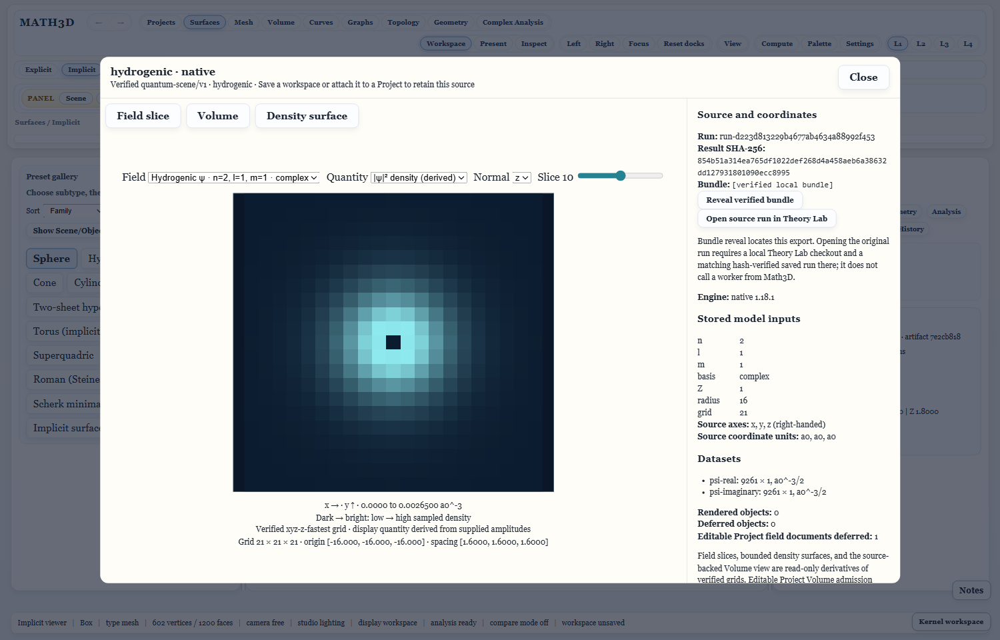

# Walkthrough: Theory Lab and Python scenes in Math3D

This desktop walkthrough checks two independent producers against the same installed Math3D application: a saved Theory Lab orbital exported as a verified `.qscene` folder, and the pinned external Python example published as a verified `.sscene` folder. It then keeps both as source-backed Project links, restarts Math3D, and checks a reversible missing-source failure. Allow about 15–25 minutes if both applications and Python are already installed.

## Before you start

- Open the **installed Math3D** from its ordinary Desktop shortcut. Have Theory Lab available for the first half and an independently installed **Python 3.10+** for the second half. Math3D does not bundle Python for this workflow.
- Choose a persistent test parent folder, such as `Documents/Math3D-scene-check`. Do not use a temporary directory: the Project links to the original scene folders instead of copying their datasets.
- Keep the complete `.qscene` and `.sscene` directories, including manifests and binary files. Choose fresh output names; neither publisher overwrites an existing scene.
- For this installed-app test, use **export in Theory Lab → manual import in Math3D**. Theory Lab's direct **Open in Math3D** currently launches a built source checkout, which would test a different executable.

The source hashes check that the scene bytes have not changed since publication. They do not certify the producer's scientific correctness or identity. Both views are read-only in Math3D; it does not call the Theory Lab worker.

## A. Export and inspect a Theory Lab orbital

1. In Theory Lab, open **Orbitals** (or **Atomic orbitals**), select the **2p** preset, and click **Compute orbital**. An existing saved 2p orbital run also works.
2. Open **Scenes** (or **Portable scenes**) and select that saved run. If you just computed it and it is absent, refresh the saved-run list. Verify that the scene names the intended run and orbital before exporting.
3. Click **Export scene bundle**. Pick your test parent folder. Theory Lab creates a new `<run-id>.qscene` directory with `bundle.json`, `scene.json`, and referenced binary datasets. Note the exact directory name; do not select an individual file later.
4. In installed Math3D choose **File → Open verified quantum scene**, and select the whole `.qscene` directory. The preview should open only after Math3D verifies its manifest, schema, and dataset hashes.
5. Try **Field slice**, **Volume**, and **Density surface** if offered by this scene. Move the slice or select a visible sample. Check the right-hand source panel for the saved run, coordinates, units, datasets and supplied model inputs. A density display is derived from the supplied orbital amplitudes; Math3D has not calculated a new orbital.
6. Close the preview. In **Projects → Contents → Quantum scenes**, choose **Attach open verified scene**, then **Save project**. The Project should list the source as a read-only link. It may also offer **Add read-only Project document**; that optional document is not needed for this walkthrough.



*Representative pinned 2p example from an earlier Math3D capture, not the particular Theory Lab run you export. Your parameters and camera may differ. [See the corresponding density surface](assets/screenshots/quantum-scenes-design-2026-10-12/07b-hydrogen-2p-surface.png).*

If you do not have a working Theory Lab run yet, **File → Verified quantum examples → Hydrogenic · 2p** is a useful viewer-only rehearsal. It does **not** replace steps 1–3 or test the Lab export boundary.

## B. Publish and inspect the Python reference scene

1. In Math3D choose **File → Verified quantum examples**. Under **Scientific interchange proof**, click **Publish with reference Python script…**.
2. In the native pickers choose your installed `python.exe` and the offered `sincos-grid.json` example. The **Choose a new .sscene output directory** Save dialog may open in the spec's `integrations/python/examples` folder. Navigate to your persistent test parent folder **before** saving. Type a fresh name such as `python-sincos.sscene` in **File name** and click **Save**; do not first create a folder with that name. The publisher exclusively creates it and refuses an existing destination.
3. Back in the scrollable **Verified quantum examples** dialog, look below the Publish buttons for **Explicit local-code execution**. Check the executable, pinned script, spec, **New output** path and displayed SHA-256 hashes. Saving the path alone has not launched Python or created the `.sscene`. Click **Run trusted Python publisher**, then approve **Run external Python code?**. The reference script is pinned, but it still runs with your account permissions; this is not a sandbox. If the review box is absent, check the top of the dialog for a **Python publication refused** message.
4. The `sin(x)cos(y)` scalar-height preview should appear after verification. Click the surface or **Inspect center sample**. Check the exact grid index, coordinates, value and units. Close the preview.
5. To exercise independent reopening, use **File → Verified quantum examples → Open external .sscene folder…**, select the whole published `.sscene` directory, and inspect it again. This import does not start Python.
6. Close the preview, then choose **Projects → Contents → Scientific scenes → Attach open verified scene** and **Save project**. The link retains the source directory and manifest fingerprint, not the field array in Project JSON.

After a successful run, the chosen `.sscene` is a **directory**, not a single file. It contains `bundle.json`, `manifest.json` and a `real.f64` dataset. If it is not in your intended test parent folder, check the **New output** path from the review dialog: saving from the spec's examples folder places the generated scene there. Keep generated scenes out of a source checkout when possible, and attach only the final persistent location to your Project.

Use **Publish with custom Python script…** only for code you independently trust. It is outside this bounded reference-publisher test.

## C. Restart, reopen, and test failure safely

1. Close Math3D completely and start it again from the same installed Desktop shortcut. Open the saved Project if it is not restored automatically.
2. In **Projects → Contents**, click **Verify and view scene** for each of the two links. Both should independently verify and reopen their original source folders. The quantum and scientific entries remain distinct.
3. For a **reversible missing-source test**, first copy one *entire* scene directory to a second persistent location. Do not change any file inside either copy. Rename the original directory temporarily in Explorer, then click that Project link's **Verify and view scene**. Math3D should report the source unavailable and show no unverified preview; the rest of the Project should still open.
4. Choose **Relink source** for the unavailable entry and select the unchanged copy. Relinking should accept only an exact verified match. Click **Save project**, then **Verify and view scene** again. You can instead restore the original folder name and reopen it if you do not want to change the saved link.

Do not damage your only source folder to test tamper refusal. The automated installed-app acceptance separately covers changed dataset bytes and rejects them.

## D. Rice–Mele convergence: Lab → verified export → Math3D

This optional route checks the five-run study and its two **separate** observables.
It uses a `.qscene` directory. It does not use the Python `.sscene` publisher.

1. In **Theory Lab → Topology → Topological bands → Explore**, choose the
   **Rice–Mele pump** model. Save five compatible runs with the same cycle and
   sampling settings. A simple controlled set is `(duration, open-chain cells)`
   = `(20, 6)`, `(30, 6)`, `(40, 6)`, `(30, 4)`, `(30, 8)`. The `(30, 6)` run is
   the anchor. Each run must include both periodic and open-chain traces.
2. Open **Topology → Sweeps → Rice–Mele saved-run convergence**. Click
   **Refresh verified runs**, choose the `(30, 6)` anchor, the two other duration
   runs, and the two other width runs. Click **Link five verified runs**. The Lab
   checks all source hashes and the controlled parameter matches before saving
   the immutable study.
3. In the saved study click **Export read-only study .qscene**. Choose a persistent
   parent directory and note the full newly created `*-convergence.qscene`
   folder path shown by the Lab. Keep the entire folder together.
4. In Math3D choose **File → Open verified quantum scene** and select that
   `.qscene` folder. The **Rice–Mele · saved-run convergence evidence** profile
   shows two plots: periodic charge versus duration in **electron charge / cell**,
   and open-chain central-bond charge versus width in **electron charge**.
   Click a duration or width point to reverify its exact scalar value, dataset
   index, source run ID, hash, status and recorded diagnostics. The source panel
   labels the whole export as a **Study**; it is not itself a saved Lab run.
   The generic **Open source run** action is therefore absent for this scene.
   After selecting a point, click **Open selected run in Theory Lab**. Math3D
   rechecks the `.qscene` and that point's run ID and hash before handing them
   to the selected installed Lab app or built checkout. On first use choose
   **Installed application** and select `Quantum Hamiltonian Lab.exe`, or choose
   **Source checkout** and select its root folder. Lab then verifies its own
   saved run before opening.
5. Close and restart Math3D, then reopen the same folder or its saved Project
   link. No point should start selected; choose one again to check source
   re-verification. For a quick viewer rehearsal without creating Lab runs, use
   **File → Verified quantum examples → Rice–Mele · five-run convergence**.

The pinned example is a viewer rehearsal: its five producer run IDs are not
installed in your local Theory Lab. **Open selected run in Theory Lab** on that
example will start Lab with an exact source identity, but Lab should report the
run unavailable. To test successful navigation, export a study from runs saved
in your own Lab profile and keep those runs. If a run has been deleted or its
hash changed, Lab refuses it. If any bundle file is missing or changed, Math3D
refuses the handoff before starting Lab.

For a reproducible **real two-app acceptance**, build both checkouts, then run
the following in the Math3D checkout on Windows:

```powershell
$env:QLAB_E2E_CHECKOUT = 'C:\path\to\theory-lab'
npx playwright test tests/e2e/quantum-rice-mele-two-app.spec.ts --reporter=list
```

The test creates a temporary `rice-roundtrip-*` root containing an isolated Lab
profile, five newly computed saved runs, and their exported `.qscene`. It opens
that export in Math3D, selects the duration-30 periodic point and width-8 chain
point, then observes each **real Lab window** over a loopback test-only DevTools
connection. Each window must show the selected verified run ID, never the study
ID. The test also removes one saved run and changes its result bytes in turn;
Math3D can still verify the unchanged export, while Lab must refuse each source
run. Test processes and the temporary root are cleaned up afterward. No user
profile, scientific data, or rendering path is changed.

To repeat the route with installed executables, build the Theory Lab Windows
installer with `npm run package:win:installer` and install it into a new
directory. Build Math3D with its complete Python worker, web assets, and the
normal Windows installer configuration:

```powershell
npm run build:python-worker
npm run build:core
npm run build:web
$env:MATH3D_CHANNEL = 'dev'
.\node_modules\.bin\electron-builder.cmd --win nsis --config electron-builder.config.cjs --publish never
```

Install the generated `release-dev/Math3D Dev Setup *.exe` into another new
directory. The dev channel uses the normal installer configuration and full
resources under a distinct app identity, preserving any existing stable
Math3D installation. A stable release uses the same configuration with
`MATH3D_CHANNEL=stable` and outputs to `release/`. Then run:

```powershell
$env:QLAB_E2E_CHECKOUT = 'C:\path\to\theory-lab' # fixture producer only
$env:QLAB_E2E_INSTALLED_EXE = 'C:\path\to\Quantum Hamiltonian Lab.exe'
$env:MATH3D_E2E_INSTALLED_EXE = 'C:\path\to\Math3D Dev.exe'
npx playwright test tests/e2e/theory-lab-installation-settings.spec.ts --reporter=list
npx playwright test tests/e2e/quantum-rice-mele-two-app.spec.ts --reporter=list
```

The fixture producer still runs from the checkout to create five controlled
saved runs. Both interactive windows and the selected-run handoff use the
installed executables. The test reads Math3D's saved target preference, rather
than a test environment override, and checks **Settings → Theory Lab
installation → Validate again**. It repeats a selection after Math3D restart,
then checks missing-run and changed-run refusal in the installed Lab. Ordinary
use of the two installed apps needs no source checkout; keep the original saved
runs in the Lab profile used to produce the exported scene.

For ordinary use, open Math3D **Settings → Theory Lab installation → Choose
installed application…**, select `Quantum Hamiltonian Lab.exe`, and confirm
the **Ready · installed application** status and path. **Validate again**
rechecks the files if the installation has moved or changed. The selection is
stored in Math3D's user profile. A source checkout remains available as an
explicit alternative.

On Windows, 2026-10-28, the complete dev-channel Math3D NSIS installer
(413,644,513 bytes) and a fresh Theory Lab NSIS install passed these two
installed-app tests: Settings target validation (1/1, 2.9 s) and the five-run
round trip (1/1, 24.8 s). The installed Math3D resources included its frozen
worker, web app, quantum examples, and Python publisher. The dev channel uses
the normal package configuration and a separate product identity; a stable
Math3D upgrade was not exercised by this isolated signoff.

The scene's 3D point positions are normalized for layout. The plots label their
physical axes from the producer's saved metadata, and selection checks values
against verified binary datasets. Math3D verifies the exported bundle; it does
not fetch or recalculate the five original Lab runs. Plot lines connect supplied
samples only. There is no extrapolation or claim that the two charges share a
limit. Automated acceptance covers restart, changed bundle bytes and missing
source files; keep your own export intact.

## Record the result

For each source, note whether import, sample inspection, Project attachment, restart reopening and missing-source refusal were clear. Also note how many clicks it took to find the scene again, whether the right-hand inspector answered your questions, and whether the initial camera showed the important structure. These observations—not another physics calculation—determine whether the deferred [SSR-07 workspace and inspector proposal](scientific-scene-runtime-roadmap.md) is needed.

If a step fails, keep the scene directory and report the exact button, message, scene type and Math3D version. For protocol and format details see the [Theory Lab scene handoff](https://github.com/expert10000/theory-lab/blob/main/docs/SCENE_HANDOFF.md), [quantum Project links](quantum-scene-project-links.md), and [Python publication workflow](scientific-scene-python-job-workflow.md).
