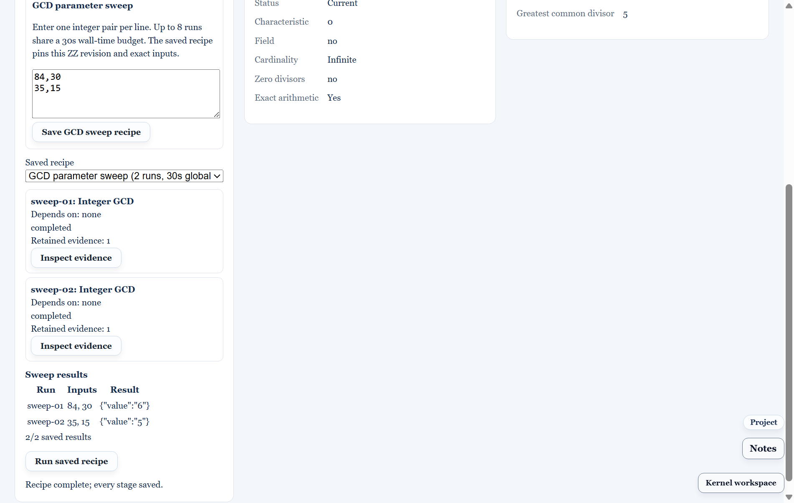

# Reproduce an algebra Project in Math3D

This tutorial uses the **CAS → Algebra** workspace and a named `.math3d` Project. It covers four exact structures, a bounded GCD sweep, saved evidence, and an inert reproducibility manifest. The definitions and arithmetic below are mathematical checks, not claimed traces of Sage's internal algorithms.

## Prepare the Project and runtime

1. Open **Projects**, create or open a named Project, then open **CAS → Algebra**.
2. In **Structures**, expand **Curated algebra examples**. Each **Save example** action adds its parent chain and primary object together. Selecting the saved object shows its definition and revision in the Inspector.
3. Open **Compute Center → Runtimes** to see available Sage routes. A structure can be saved without Sage. **Operations** and **Recipes** show why a required route is unavailable.

The local adapter used for this tutorial gate is WSL Sage 9.5. The archived [B08 runtime matrix](../evidence/sage-b08-live-2026-11-05.md) recorded 16/16 cases on Sage 9.5 and Docker Sage 10.10 with zero differences. That record does not assert that Docker is running today. The desktop sweep acceptance uses a controlled Sage-shaped endpoint to check the UI and saved-evidence path; the exact tutorial facts were separately checked on real WSL Sage 9.5.

The saved object schema and revision rules are defined in [algebraObjects.ts](../../packages/core/src/algebraObjects.ts) and [projectAlgebraRegistry.ts](../../packages/core/src/projectAlgebraRegistry.ts). The bounded request types and supported domains are in [algebraOperationRegistry.ts](../../packages/core/src/algebraOperationRegistry.ts). Saved sweep graphs use the `math3d.algebra-recipe` v1 contract; exports use `math3d.algebra-repro-manifest` v1. These files are the exact API contracts for this build.

## Example 1: the five-element field

Choose **Five-element field**. The saved versioned definition is `GF(5)` with characteristic `5`, extension degree `1`, and canonical construction. Its elements are the residue classes `0,1,2,3,4`; each nonzero class has a multiplicative inverse: `1⁻¹=1`, `2⁻¹=3`, `3⁻¹=2`, `4⁻¹=4`. Thus its cardinality and characteristic are both `5`.

**Hypothesis and failure:** the characteristic in a prime field must be prime. A proposed prime-field characteristic `9` fails validation. A field with nine elements would instead have characteristic `3` and degree `2`; that is a different definition.

## Example 2: the cyclic group of order four

Choose **Cyclic group C4**. Write its generator as `g`, with `g⁴=e`. Its elements have orders `1,4,2,4` for `e,g,g²,g³`. Its three subgroups are `{e}`, `{e,g²}`, and the full group. The group card shows the versioned permutation presentation; the exact order and subgroup count can be verified by the group Inspector and the supplied Sage check.

**Hypothesis and failure:** a claimed generator action must be a valid permutation and satisfy the presentation. A malformed image or inconsistent order is rejected by the finite-group validator. The gallery's expected values do not make an arbitrary edited group definition valid.

## Example 3: a nonreduced affine ideal

Choose **Nilpotent affine ideal**. One save adds `QQ`, `R=QQ[x,y]` with degree-reverse-lexicographic order, and `I=(x²,y)`, each with a stable Project ID and revision. The leading terms are `x²` and `y`, so the standard monomials of `R/I` are `1,x`. In the quotient, `x≠0` while `x²=0`, and `y=0`. Membership and normal-form checks are:

| Input | Member of `I`? | Normal form modulo `I` |
|---|---:|---|
| `1` | No | `1` |
| `x` | No | `x` |
| `x²` | Yes | `0` |
| `y` | Yes | `0` |

Select the ideal and use **Operations** for the bounded Gröbner, membership, or normal-form controls when advertised by the route. The exact output is pinned to the ideal revision and its ambient ring. A generator `z` is invalid for this saved `QQ[x,y]` ring. A later parent-ring revision makes dependent current views stale; the historical result remains attached to the old revision.

## Example 4: a torsion module

Choose **Torsion module Z/6Z**. One save adds `ZZ` and the rank-one module presentation with relation matrix `[6]`. The Smith diagonal is `[6]`, giving invariant factor `6` and free rank `0`: `ZZ/6ZZ`. Select the module and run **Module invariant factors** when its Sage capability is available. The saved Inspector result should cite the module revision and relation matrix.

**Hypothesis and failure:** the relation matrix shape must match the presentation ranks. A mismatched row count is rejected before execution. The statement `ZZ/6ZZ` depends on the integer base ring; the same matrix over `QQ` has a different module meaning.

## Save a repeatable experiment

Select **Gallery ZZ**, open **Recipes**, and enter these rows in **GCD parameter sweep**:

```text
84,30
35,15
17,13
```

Choose **Save GCD sweep recipe**, then explicitly **Run saved recipe**. The expected results are `6,5,1`: for example, `84=2·30+24`, `30=1·24+6`, and `24=4·6`, so `gcd(84,30)=6`. Each successful run gets its own saved evidence with exact inputs, target revision, route, version and result hash. The results table reports the count retained after cancellation or partial failure. At most eight rows run under one 30-second wall-time budget; noncanonical integers such as `02` are rejected. Saving or importing a recipe never runs it automatically.



## Export and independently check the evidence

1. Save the Project and export its `.math3d` bundle through **Projects**. In **Workbook**, open **Publish selected report blocks** and choose **Export algebra manifest + report**. The `.algebra.json` file contains versioned object definitions, bounded operation requests, saved result hashes, runtime and certificate metadata, recipes and selected Workbook algebra/code sources. The `.algebra.md` file is the readable report. **Export algebra manifest with results** includes result snapshots.
2. In a fresh profile, import the Project bundle and inspect the same IDs, revisions and results. The manifest parser treats any embedded trusted Sage code as inert text; execution requires a separate local trust action.
3. To check exported files outside the UI, run:

```text
npm run check:sage:algebra-manifest -- report.algebra.json project.math3d
```

If you also have the serialized Workbook JSON, append `--workbook workbook.json` to compare its selected blocks. When the Project has a Workbook reference, the command also checks that Workbook's byte checksum. The output distinguishes `workbookVerified` (blocks checked against the supplied file) from `workbookProjectBound` (that file matches a Project reference). Without a Workbook file it still checks every Project algebra object, operation and recipe. A changed Project revision, result, certificate or manifest hash fails. The command only reads data and does not dispatch Sage work.

The [H06 exact Sage check](../../scripts/check-sage-algebra-h06-tutorial.py) prints machine-readable results for all four examples and the GCD values. Run it through an installed Sage Python interpreter; its [WSL Sage 9.5 result](../evidence/sage-h06-tutorial-facts-wsl-9.5-2026-11-06.json) is retained for review. `npm run check:sage:release` audits the historical M0–M6 evidence and B08 artifact; a new live release run still requires the runtime routes and `npm run test:sage:f08`.
